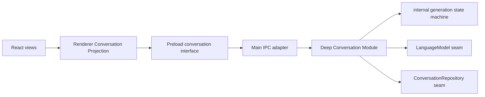

# Canonical Message 与生成生命周期实施计划

## 状态

- 状态：Proposed
- 优先级：P0
- 前置依赖：[持久会话与历史恢复实施计划](./2026-09-03-persistent-conversation-module.md)
- 主要交付：每条消息从首次出现起使用 canonical `messageId`；生成、完成、失败、取消和重试由 Conversation Module 统一维护。

## 目标

修复当前将 `requestId` 临时当作 assistant 消息 ID、收到 `completed.messageId` 后未替换的问题，并把相关状态规则深化进 Conversation Module。

目标不只是增加一次 `requestId → messageId` 赋值，而是建立以下长期不变量：

1. `requestId` 只标识一次运行期请求，用于事件关联和取消；永远不是消息身份。
2. `messageId` 由 Core 创建，是消息在事件、Renderer 和 SQLite 中唯一且稳定的身份。
3. assistant 消息在 `started` 首次出现时就携带 canonical `messageId`；`chunk` 和终态事件始终携带同一个 ID。
4. Renderer 消息集合只以 `messageId` 为 key，不把 `requestId` 写入消息实体。
5. 一次请求恰好进入一个终态：`completed`、`cancelled` 或 `failed`；终态后不再接受 chunk。
6. failed/cancelled 不产生伪持久化 assistant 消息；已持久化的 user 消息成为明确的可重试对象。
7. retry 不重复写入 user 消息，并为新的 assistant 回复分配新的 canonical `messageId`。

## 当前问题

- `App.tsx` 在 `started` 时使用 `event.requestId` 创建 assistant 占位。
- `chunk` 继续按 `requestId` 查找并修改这条占位。
- `completed` 返回真正的 `messageId`，但 Renderer 没有 re-key。
- 输出过 chunk 后如果模型或 assistant 持久化失败，UI 会保留一条看似有效、实际未持久化的部分回复。
- 取消只停止模型流；UI 删除空占位，但对非空部分回复没有一致处理。
- `cancel()` 的 IPC Promise 没有统一失败处理。
- 所有事件归并、终态清理和展示规则都在 `App.tsx`，拆分 UI 后会向多个调用者泄漏。

## 范围分界

本计划负责：

- canonical user/assistant `messageId`
- `requestId` 与消息身份分离
- started/chunk/completed/failed/cancelled 状态机
- 同一会话的活动请求约束
- failed/cancelled 后的可重试语义
- Renderer 中可独立测试的事件 Projection
- sender 所有权和窗口销毁时的请求清理

本计划不负责：

- Conversation list/create/load 和会话目录；它们由前置计划完成。
- 会话标题、删除、搜索或分页。
- 失败尝试审计、部分回复跨重启恢复或对话分叉。
- `turns`、`attempts` 或消息状态持久表。

## 架构决定

### 1. 深化同一个 Conversation Module

前置计划建立的 Conversation Module 继续作为唯一对外 Seam。生成生命周期是其 Implementation 内部能力，不新增平级的“Turn Manager”或“Message Service”等浅 Module。



Conversation Module 隐藏身份分配、合法状态迁移、模型执行、持久化、取消、并发和重试规则，从而提高 Locality。Main、React 和测试只学习一个 Conversation Interface，从而获得 Leverage。

### 2. 消息身份与请求身份严格分离

持久消息继续使用最小模型：

```ts
interface ConversationMessage {
  messageId: string
  sessionId: string
  role: 'user' | 'assistant'
  content: string
  createdAt: string
}
```

`requestId` 只存在于：

- 活动请求索引
- `AbortController` 查找
- IPC send/cancel/retry 命令
- 流式事件关联信息

`requestId` 不允许进入 `ConversationMessage`、`StoredMessage.id`、React key 或重试目标。

### 3. Core 在执行开始时预分配 canonical IDs

首次发送固定按以下顺序执行：

1. 校验 `sessionId` 存在，且该会话没有其他活动生成。
2. 创建 canonical `userMessageId` 和 `assistantMessageId`。
3. 注册 `requestId → execution` 和 `sessionId → requestId`。
4. 持久化 user 消息。
5. 发出 `started`，携带 canonical user 消息和 `assistantMessageId`。
6. 读取该会话 history，调用 `LanguageModel` 并流式发出 chunk。
7. 成功时使用预分配的 `assistantMessageId` 持久化完整 assistant 消息，然后发出 completed。
8. 在 `finally` 清理两个活动索引。

`started` 的语义是“user 消息已经持久化、生成身份已经建立”，而不是“IPC 请求刚刚收到”。如果 user 写入失败，不得发 started，也不得在 UI 创建伪消息。

如果取消发生在 user append 期间，append 完成后仍先发 started，再发 cancelled，使 UI 与数据库中已经存在的 user 消息保持一致。

### 4. Send 结果和事件都自包含 canonical identity

建议共享以下起始载荷：

```ts
interface GenerationStarted {
  requestId: string
  sessionId: string
  userMessage: ConversationMessage
  assistantMessageId: string
}

interface SendMessageResult {
  accepted: true
  generation: GenerationStarted
}
```

事件语义：

```ts
type ConversationEvent =
  | ({ type: 'started' } & GenerationStarted)
  | { type: 'chunk'; requestId: string; sessionId: string; messageId: string; delta: string }
  | { type: 'completed'; requestId: string; sessionId: string; message: ConversationMessage }
  | { type: 'cancelled'; requestId: string; sessionId: string; messageId: string }
  | { type: 'failed'; requestId: string; sessionId: string; messageId?: string; error: SafeError }
```

约束：

- chunk/cancelled 的 `messageId` 必须等于 started 的 `assistantMessageId`。
- completed 返回完整的已持久化 assistant 消息，其 `messageId` 必须相同。
- user 持久化前失败时，failed 没有 `messageId`；started 后失败则必须携带 assistant `messageId`。
- send 结果和 started 事件可能乱序到达 Renderer；二者使用同一载荷，Projection 按 canonical ID 幂等归并，不能依赖偶然时序。

### 5. 当前 re-key 缺陷先用回归测试锁定

实施第一步先针对当前协议写失败测试：收到 `completed.messageId` 时，Renderer 必须以一个不可分割的 reducer transition 将 `requestId` 占位替换为 `messageId`，并删除旧 key。

随后立即升级协议，使 started 已携带 canonical `assistantMessageId`，删除 steady-state 中以 `requestId` 创建消息的路径。最终 reducer 保留协议一致性检查：若 completed 的 `messageId` 与活动请求映射不一致，拒绝污染消息集合并报告安全的协议错误。

最终代码不得为了旧协议长期保留双 ID 消息类型。

### 6. failed/cancelled 删除 assistant draft，保留 user

本阶段不持久化 streaming/failed/cancelled assistant draft：

- **completed**：持久化完整 assistant 消息成功后，发 completed；Projection 用持久化消息覆盖流式 draft。
- **model failed**：不持久化 assistant draft；发 failed；Projection 删除该 canonical draft，保留 user，并显示可重试状态。
- **assistant append failed**：发 `PERSISTENCE_ERROR`；Projection 删除 draft，不能把累计内容显示成已保存回复。
- **cancelled**：不持久化 assistant draft；Projection 删除部分 draft，保留 user，并显示 cancelled/retryable。
- **应用异常退出**：数据库只留下最后一条 user 消息；下次 load 后将“最后一条没有 assistant 回复的 user 消息”投影为 retryable，不会出现永久 generating。

这组规则使用现有消息表即可表达，避免为了运行期尝试引入 `turns`、`attempts`、`status` 或 `request_id` 列。只有产品明确要求重启后查看失败/取消尝试和部分内容时，才另开持久化迁移计划。

### 7. 每个会话最多一个活动生成

Conversation Module 同时维护：

- `requestId → execution`
- `sessionId → requestId`

同一会话的第二次发送返回类型化 `CONVERSATION_BUSY`。不同会话可以并行。该规则属于 Core；Renderer 可以根据投影禁用输入，但不能成为唯一防线。

### 8. retry 只处理最后一条未回答 user 消息

第一版重试命令输入 `sessionId + userMessageId + new requestId`：

1. Core 验证 user 消息存在、属于该会话、role 为 user，并且是会话最后一条尚未获得 assistant 回复的消息。
2. 不再次 append user 消息。
3. 分配新的 canonical `assistantMessageId`。
4. 复用正常的 started/chunk/terminal 执行路径。

过期、重复或会造成对话分叉的 retry 返回类型化错误。本阶段不支持重试已有成功回复。

### 9. Main 维护 sender 所有权

Main IPC Adapter 记录每个活动 `requestId` 的 `WebContents.id`：

- 只有创建请求的 sender 能取消该请求。
- sender 销毁时取消其全部活动请求。
- 发送事件前继续检查 `sender.isDestroyed()`。
- sender 映射在任意终态和异常路径清理。

这使多窗口能力增长时，请求清理规则仍集中在一个位置。

## Renderer Conversation Projection

将协议协调从 `App.tsx` 移到可独立测试的纯状态 Module：

```text
src/renderer/src/conversation/
├── conversation-state.ts      # 状态与纯 reducer
├── conversation-controller.ts # window.api 调用、订阅与清理
└── conversation-state.test.ts # ID、乱序、终态和 stale event
```

Projection Interface 保持窄：React 读取状态并提交 `send/cancel/retry` 意图。以下知识隐藏在 Implementation 中：

- send 结果和 started 事件的乱序归并
- `requestId → assistantMessageId` 活动索引
- canonical user/assistant 消息 upsert
- chunk 归并
- completed 内容对账
- failed/cancelled draft 删除与 retryable user
- 会话切换时忽略旧事件
- IPC send/cancel/retry Promise 失败

`App.tsx` 只负责布局和展示，不直接 map 协议事件。

## Store Seam 的最小扩展

本计划不增加 schema 版本。Conversation Repository 只需补足：

- 通过 `sessionId + messageId` 查找消息。
- 判断指定 user 是否是最后一条未回答消息。
- 使用预分配的 assistant `messageId` append 完整回复。

若判断逻辑可以由一次有序 history 在 Core 中完成，不新增专用 Repository 方法。优先保持 Seam 小，除非性能测量证明需要下推查询。

## 实施步骤

### Slice 1：用 reducer 测试锁定当前缺陷

- [ ] 提取最小纯 reducer，以现有事件协议重现 `requestId` 占位。
- [ ] 增加 completed 时原子 re-key 为 `messageId` 的失败测试并修复。
- [ ] 断言 re-key 后不存在旧 `requestId` key，React key 使用 `messageId`。
- [ ] 覆盖重复 completed、未知 requestId、session 不匹配和迟到终态。

### Slice 2：Core canonical identity 与状态机

- [ ] 在 Conversation Module 内预分配 user/assistant canonical IDs。
- [ ] 将 started 移到 user 持久化成功之后。
- [ ] 建立 request/session 活动索引和每会话单生成规则。
- [ ] 所有 chunk 和终态使用预分配的 assistant ID。
- [ ] 保证 assistant 持久化成功后才发 completed。
- [ ] 统一 completed/cancelled/failed 的一次性终态和 `finally` 清理。

### Slice 3：Shared、Main 与 Preload 协议升级

- [ ] 更新 Zod schema，使 started/send result 自包含 canonical IDs。
- [ ] 更新 chunk/completed/cancelled/failed 的 message identity。
- [ ] 为 `CONVERSATION_BUSY`、retry 拒绝和 cancel 失败定义安全错误。
- [ ] Main Adapter 增加 sender 所有权和 WebContents 销毁清理。
- [ ] preload 对所有新输入、结果和事件执行运行时解析。

### Slice 4：Renderer Projection 与 React

- [ ] 新建 reducer/controller，替换 `App.tsx` 内的事件分支。
- [ ] `DisplayMessage` 改为显式 `messageId`，移除模糊的 `id` 字段。
- [ ] send result/started 均按 canonical ID 幂等 upsert。
- [ ] chunk 只能更新映射到同一 request 的 assistant draft。
- [ ] completed 用持久化消息完成对账；failed/cancelled 删除对应 draft。
- [ ] 终态只清理自己的 `requestId`，不能误清理新会话或新请求。
- [ ] send/cancel/retry Promise 失败进入安全状态，不产生未处理 rejection。

### Slice 5：Retry

- [ ] 新增 retry input/result schema、IPC handler 和 preload 方法。
- [ ] Core 校验“最后一条未回答 user”不变量。
- [ ] retry 不重复写入 user，为 assistant 创建新的 canonical ID。
- [ ] load 后若最后一条是 user，Projection 将其标记为 retryable。

### Slice 6：运行期纵切验证

- [ ] Electron 测试覆盖发送、chunk、完成、失败、取消和 retry。
- [ ] 断言 UI 第一次渲染消息就使用 canonical `messageId`。
- [ ] 验证窗口销毁会取消其请求，并且重启后只恢复持久消息。

## 测试矩阵

| 场景 | Core 持久状态 | Renderer Projection |
| --- | --- | --- |
| success | 一个 user + 一个 assistant；事件和 DB assistant ID 相同 | draft 原位变 completed，不换 canonical key |
| user append 失败 | 无新增消息 | 不创建伪消息；显示安全错误 |
| 首 chunk 前 model 失败 | 只保留 user | 删除 assistant draft；user 可重试 |
| 多个 chunk 后 model 失败 | 只保留 user | 删除部分 draft；user 可重试 |
| assistant append 失败 | 只保留 user | 不误显示 completed；user 可重试 |
| chunk 后 cancel | 只保留 user | 删除部分 draft；显示 cancelled/retryable |
| started 后立即 cancel | 只保留 user | 无永久占位 |
| retry success | 原 user 仍只有一条；新增一个 assistant | 不重复 user；新 assistant 使用新 ID |
| 重复或过期 retry | 无写入 | 类型化失败；不破坏当前状态 |
| load unanswered user | 原数据不变 | 显示 retryable |
| stale event | 无影响 | 不清理另一个请求，不修改错误消息 |

额外测试：

- started 与 send result 以两种顺序到达，结果相同。
- 重复 started/chunk/terminal 不产生重复消息。
- completed messageId 与活动映射不一致时拒绝合并。
- 同 session 第二次发送被拒，不同 session 可并行。
- 取消只能由原 sender 发起，sender 销毁触发清理。

## 验收标准

- [ ] Renderer 消息类型和 React key 不再使用 `requestId`。
- [ ] 任意 assistant 消息从第一次出现在 UI 和事件中，到最终写入 SQLite，都使用同一个 `messageId`。
- [ ] completed 返回 canonical message 后，集合中不存在旧 `requestId` 占位或重复 assistant 消息。
- [ ] 完成、失败和取消都只影响其自身请求，并且恰好产生一个终态。
- [ ] 部分输出后失败/取消不会留下看似已保存的 assistant 消息。
- [ ] retry 不复制 user 消息，并使用新的 assistant `messageId`。
- [ ] 应用重启后，最后一条未回答 user 可以再次重试，不会永久显示 generating。
- [ ] React views 不包含事件顺序、ID 对账、并发或重试资格规则。
- [ ] Core 状态机和 Renderer Projection 都可通过各自 Interface 独立测试。
- [ ] `pnpm lint`、`pnpm typecheck`、`pnpm test`、`pnpm build` 全部通过。
- [ ] Electron 完整纵切测试在本机环境通过。

## 风险与控制

- **send 结果与 started 事件乱序**：两者共享 canonical 起始载荷，Projection 幂等 upsert，不假设时序。
- **状态机散落**：合法领域迁移只在 Conversation Module Implementation 中定义；Renderer 只做事件投影与协议防御。
- **失败 partial 丢失引起困惑**：第一版明确删除未持久化 draft；如果产品要求保留失败尝试，再单独设计持久状态，而不是偷偷混入成功历史。
- **重试形成分叉**：只允许最后一条未回答 user，拒绝已有成功回复的重试。
- **多窗口串扰**：Main 维护 sender 所有权，Core 维护 session 并发，两处职责不同且均有测试。

