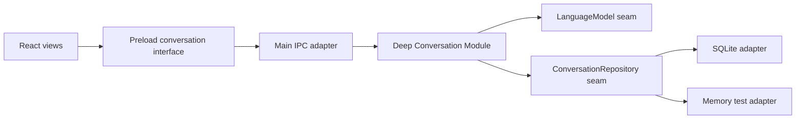

# 持久会话与历史恢复实施计划

## 状态

- 状态：Implemented（2026-09-03）
- 优先级：P0
- 前置依赖：无
- 后续计划：[Canonical Message 与生成生命周期实施计划](./2026-09-03-canonical-message-lifecycle.md)

## 目标

把当前只能“写入消息、供模型读取”的会话切片，深化为一个完整的 Conversation Module。该 Module 应拥有稳定的 `sessionId`、会话创建、会话列表、历史加载和当前会话恢复；Renderer 不再自行决定持久会话身份。

完成后必须满足：

1. `sessionId` 由 Conversation Module 创建并持久化，不由 React 挂载时随机生成。
2. 应用重启后可以列出已有会话，并用 `sessionId` 读取完整历史。
3. `load(sessionId)` 在 Core 内组合会话元数据与有序历史，Renderer 不需要分别调用并自行拼装。
4. 空数据库会自动创建一个可用会话；已有数据库中的历史消息不会丢失。
5. Renderer 只通过 preload 暴露的窄 Interface 使用 Conversation Module。
6. SQLite、迁移和恢复规则都隐藏在 Module 的 Implementation 内，调用者无需理解数据库结构。

## 当前问题

- `src/renderer/src/App.tsx` 在每次挂载时生成新的 `sessionId`，同一份 SQLite 数据在重启后无法重新选中。
- `ConversationStore.history()` 只被 Core 用来组装模型上下文，没有通过 Main / preload 向 Renderer 提供读取路径。
- 数据库只有 `conversation_messages`，没有可列出、排序或恢复的会话实体。
- `ConversationSession` 同时表达单次生成编排和整个会话概念；随着列表和恢复加入，它的 Interface 会越来越浅。

## 架构决定

### 1. 只保留一个对外 Conversation Seam

Main 和测试通过一个 Conversation Module Interface 使用会话能力。该 Interface 覆盖最小完整生命周期：

```ts
interface ConversationModule {
  createConversation(): Promise<ConversationSummary>
  listConversations(): Promise<ConversationSummary[]>
  loadConversation(sessionId: string): Promise<LoadedConversation>

  // 现有生成能力保留；Plan 2 会深化其消息身份和状态语义。
  sendMessage(
    input: SendMessageInput,
    emit: ConversationEventListener
  ): Promise<SendMessageResult>
  cancelMessage(requestId: string): void
}
```

方法名是计划级目标，实施时可以按仓库命名习惯调整，但必须保留以下 Interface 不变量：

- `createConversation` 返回已经持久化的会话摘要。
- `listConversations` 按 `updatedAt DESC, createdAt DESC` 稳定排序。
- `loadConversation` 返回会话元数据和按创建顺序排列的消息；未知 `sessionId` 返回类型化的 `NOT_FOUND` 错误，不能静默创建。
- Renderer Interface 不单独暴露 `history(sessionId)`；加载规则由 Core 完成，避免形成需要调用者拼装的浅 Interface。
- `sendMessage` 只能写入已经存在的会话。
- Renderer 永远不直接调用 Repository Adapter。

### 2. Repository 是 Conversation Module 的内部 Seam

将目前定义在 `conversation-session.ts` 内的存储类型移到 Core 的 Conversation 领域中。SQLite Adapter 和测试用 Memory Adapter 均满足同一内部 Interface，这两个 Adapter 证明该 Seam 真实存在。

建议的内部能力：

```ts
interface ConversationRepository {
  create(conversation: StoredConversation): Promise<void>
  list(): Promise<StoredConversation[]>
  find(sessionId: string): Promise<StoredConversation | undefined>
  history(sessionId: string): Promise<StoredMessage[]>
  appendMessage(message: StoredMessage): Promise<void>
}
```

Repository 只负责持久化语义；“不存在时是否允许发送”“启动时选哪个会话”等规则留在 Conversation Module，以维持 Locality。

### 3. Renderer 的启动恢复策略必须确定且简单

启动流程固定为：

1. 调用 `listConversations()`。
2. 有记录时打开排序第一的最近会话。
3. 无记录时调用 `createConversation()`，再加载并显示该会话。
4. 用户切换会话时，以 `loadConversation(sessionId)` 的结果整体替换当前投影。

本阶段不新增独立的“最近选择”设置。`updatedAt` 最近的会话就是默认恢复对象，避免为了一个 Adapter 引入新的 Seam。

## 目标依赖关系



Conversation Module 的 Depth 来自：一个小 Interface 隐藏会话身份、恢复策略、存在性校验、排序和持久化协调。删除该 Module 会让这些规则重新泄漏到 Main、Renderer 和测试，因此它通过 deletion test。

## 数据模型与迁移

### Schema v2

新增 `conversations` 表：

```sql
CREATE TABLE conversations (
  id TEXT PRIMARY KEY,
  created_at TEXT NOT NULL,
  updated_at TEXT NOT NULL
);

CREATE INDEX conversations_updated_at
  ON conversations (updated_at DESC, created_at DESC);
```

迁移后 `conversation_messages.session_id` 必须通过外键引用 `conversations.id`。Main 初始化数据库连接后在事务外执行 `PRAGMA foreign_keys = ON`；Core 仍执行存在性校验，以产生稳定的领域错误，而不是把 SQLite 错误泄漏给调用者。

### v1 → v2 迁移

除 `foreign_keys` 开关外，schema 变更必须在同一个事务中：

1. 在事务外启用 `PRAGMA foreign_keys = ON`。
2. 在迁移事务中创建 `conversations` 表和索引。
3. 从 `conversation_messages` 中按不同 `session_id` 回填会话。
4. `created_at` 使用该会话最早消息时间，`updated_at` 使用最晚消息时间。
5. 创建带 `FOREIGN KEY (session_id) REFERENCES conversations(id)` 的新消息表，将旧数据复制进去，校验行数后替换旧表并重建索引。
6. 设置 `user_version = 2`，提交事务。

消息 append 必须在同一事务中插入消息并更新所属会话的 `updated_at`，使列表排序不依赖 Main 或 Renderer 额外 touch。

## 跨进程协议

在 `src/shared/conversation.ts` 中新增并用 Zod 校验：

- `createConversationResultSchema`
- `listConversationsResultSchema`
- `loadConversationInputSchema`
- `loadConversationResultSchema`
- `conversationSummarySchema`
- `conversationMessageSchema`

跨进程数据必须仅包含可序列化值：

```ts
interface ConversationSummary {
  sessionId: string
  createdAt: string
  updatedAt: string
}

interface LoadedConversation {
  conversation: ConversationSummary
  messages: ConversationMessage[]
}
```

本计划中的 `ConversationMessage` 先兼容现有字段；Plan 2 会统一 canonical `messageId` 和运行期生成状态投影。不要在两个计划中重复定义消息状态迁移。

## 实施步骤

### Slice 1：Core 与 Memory Adapter

- [x] 新建 Conversation Module，将会话生命周期与现有生成编排收拢到同一对外 Interface。
- [x] 将 `StoredMessage`、Repository Interface 和持久化错误从 `conversation-session.ts` 中拆到 Conversation 领域文件。
- [x] 实现 `create/list/load` 规则和类型化 `NOT_FOUND` / `PERSISTENCE_ERROR`。
- [x] 在测试中实现 Memory Repository Adapter。
- [x] 保持现有成功流、取消和安全错误测试通过。

### Slice 2：SQLite Adapter 与迁移

- [x] 将内联单版本迁移改为按版本顺序执行的迁移表或迁移函数集合。
- [x] 实现 v2 schema、v1 历史回填和消息表外键重建。
- [x] 实现会话 create/list/find/messages 和消息写入后的 `updatedAt` 更新。
- [x] 确保创建会话、追加消息和更新时间更新在需要时使用事务。
- [x] 数据库文件版本高于当前支持版本时继续 fail fast。

### Slice 3：Shared、Main 与 Preload Adapter

- [x] 集中新增稳定的 conversation channel 常量，禁止在 handler 中写散落字符串。
- [x] Main 对所有输入执行 Zod 解析，并将 Core 错误转换为用户安全错误。
- [x] preload 对输入和返回值再次解析，只暴露领域命名方法。
- [x] 同步更新 `src/preload/index.ts` 与 `src/preload/index.d.ts`。

### Slice 4：Renderer 恢复

- [x] 删除 `App.tsx` 中持久 `sessionId` 的本地随机生成。
- [x] 增加 `loading / ready / failed` 启动状态，避免恢复完成前允许发送。
- [x] 按固定恢复策略 list → load，空库时 create → load。
- [x] 用 `LoadedConversation` 初始化消息列表。
- [x] 会话切换期间取消或隔离旧会话的活动请求，避免旧事件写入新会话视图。

### Slice 5：回归与运行期验证

- [x] 扩充 Electron 测试为 create → send → complete → close → relaunch → list/load → history 可见。
- [x] 在临时 `userData` 目录构造 v1 数据库，验证升级后历史可读。
- [x] 验证畸形 `sessionId`、不存在会话和数据库异常不会把内部错误暴露给 Renderer。

## 测试矩阵

| 范围 | 必测场景 |
| --- | --- |
| Core | 空库创建；列表排序；加载历史；未知会话；禁止向未知会话发送 |
| Repository | v2 新建；v1 回填；外键生效；顺序稳定；append/touch 原子性；事务失败回滚；高版本拒绝 |
| IPC / preload | 输入拒绝；结果解析；安全错误；事件订阅不回归 |
| Renderer | 启动恢复；空库创建；切换会话；恢复失败；加载中禁止发送 |
| Electron | 重启后同一 `sessionId` 和消息历史可见 |

## 验收标准

- [x] 首次启动创建的 `sessionId` 在应用重启后仍能通过列表找到并打开。
- [x] v1 数据库升级到 v2 后，每个历史 `session_id` 都有对应会话记录，消息数量和顺序不变。
- [x] Renderer 中不再存在 `useRef(crypto.randomUUID())` 形式的持久会话身份来源。
- [x] Renderer、preload 和 Main 均不导入 SQLite 实现。
- [x] Core 测试以 Conversation Module Interface 为测试面，不需要穿透其 Implementation。
- [x] `pnpm lint`、`pnpm typecheck`、`pnpm test`、`pnpm build` 全部通过。
- [x] Electron 重启恢复测试在本机环境通过。

## 非目标

- 会话标题、删除、归档、重命名和搜索。
- 历史分页、全文索引和跨设备同步。
- Prompt、Memory、Learning 或工具调用持久化。
- 真实模型配置；它可在独立纵切中通过现有 `LanguageModel` Seam 接入。

## 风险与控制

- **迁移破坏已有数据**：使用临时 v1 fixture 做升级测试；迁移始终包在事务中。
- **恢复事件污染当前会话**：Renderer 只接受 `sessionId` 与当前快照一致的事件，并在切换时处理活动请求。
- **Interface 过宽**：暂不加入 delete/rename/search；只实现 UI 历史恢复所需的完整最小生命周期。
