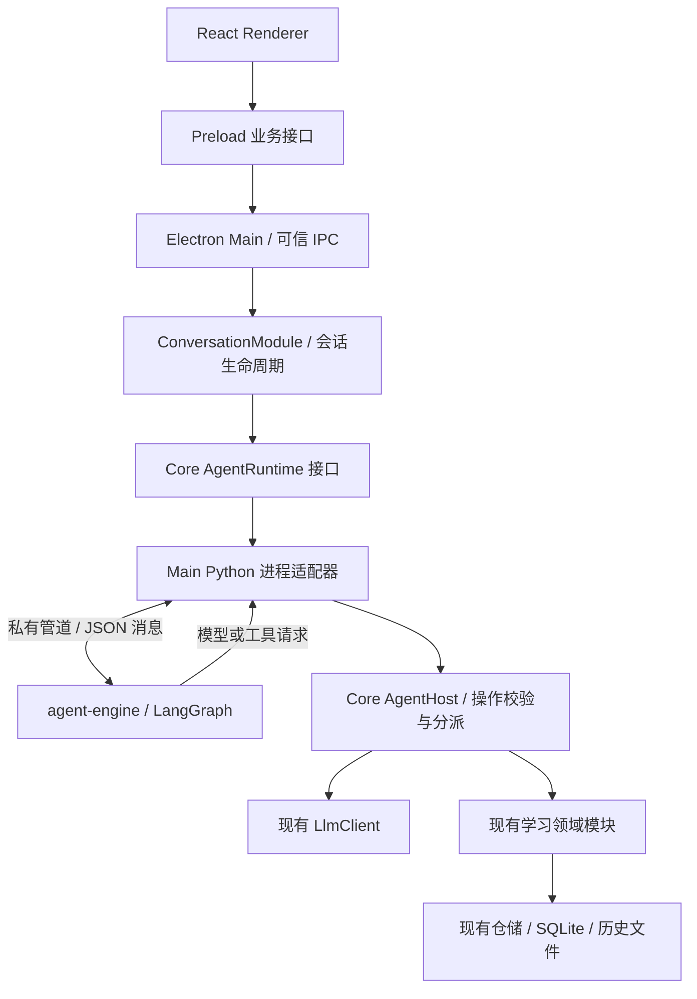

# Python LangGraph Agent Engine 模块建设计划

- 日期：2026-10-20
- 状态：实施中（功能已落地；跨平台与正式发行验收待完成）
- 技术路线：Electron Main 管理本地 Python 子进程；LangGraph 负责工作流编排，现有 TypeScript Core 负责领域执行。

## 目标与范围

创建独立的 `agent-engine/` Python 模块，作为后续编写 LangGraph 状态、节点、条件路由和学习工作流的固定位置。通过受控通信接口连接现有 Electron 应用，让新增 Agent 编排能够复用 TypeScript 中已有的模型通信、学习能力和数据访问。

本文已于 2026-10-21 进入实施。开发与验证使用隔离测试数据、模型替身和本地假服务；不执行真实用户数据库迁移，不增加 checkpoint，也不修改既有用户记录格式。实施记录见文末。

首版交付范围：

- 独立 Python 包、依赖锁定、开发入口和模块说明。
- LangGraph 运行时、可序列化执行状态、模型和工具宿主接口，以及一个参考学习工作流。
- TypeScript 侧执行接口、Main 子进程管理和双向通信适配。
- 普通对话与 `/concept` 的桌面试点接入，保留既有消息、取消、重试和用量统计语义。
- 使用假模型和受控只读工具验证“模型决策 → 工具执行 → 继续生成”的完整循环。
- 开发与打包环境中的启动、流式响应、取消、异常和退出验证。

首版聚焦架构与运行链路。自然语言自动收藏、跨技能写入流程、长期学习记忆、持久化 checkpoint、多 Agent 协作和 Telegram 接入列为后续方向，不属于本文首版完成条件。现有显式学习技能和渠道能力继续走原有路径。

## 实施前代码基线与设计取舍

下表记录本次建设的接入背景与设计取舍；当前落地情况见文末实施记录，运行及验证流程见 [Agent Engine README](../../agent-engine/README.md)。聊天平台接入仍为独立待实施计划，不代表已有渠道模块。

| 当前实现                                                                                                                                      | 本计划中的处理                                                                       |
| --------------------------------------------------------------------------------------------------------------------------------------------- | ------------------------------------------------------------------------------------ |
| `src/core/conversation/conversation-module.ts` 管理会话、消息身份、会话互斥、流式终态和技能恢复                                               | 保留其会话职责，通过依赖注入接入 Agent 执行接口；不把整个模块迁移到 Python           |
| `src/core/conversation/conversation-skill.ts` 提供领域技能执行、报告和反馈接口                                                                | 作为后续工具复用基础；不把外层会话方法当作图工具                                     |
| `src/core/llm/llm-client.ts`、`src/main/llm-client-factory.ts` 负责模型通信、超时、取消、用量账本和密钥脱敏登记                               | 继续作为实际模型请求入口，Python 不自行请求供应商                                    |
| `src/core/llm/language-model.ts` 目前仅提供文本流 Interface                                                                                   | 文本生成可直接适配；模型决策与工具调用需补充独立的受控宿主操作，不能假定原接口已支持 |
| 学习模块、工具执行器、SQLite 仓储和 JSON 历史已有校验与提交语义                                                                               | 保留 TypeScript 实现与事务归属；不让 Python 直接操作业务存储                         |
| [聊天平台接入计划](2026-09-11-chat-platform-integration.md) 规划绑定、确认、队列、幂等、outbox 和恢复政策，当前尚无 `src/core/channels/` 实现 | 首版不接入，后续渠道实现应保持独立的授权与恢复语义                                   |
| `electron-builder.yml` 尚无 Python 运行包构建流程                                                                                             | 新增按操作系统及 CPU 架构分发的运行包与安装后验证                                    |

历史架构清单（原路径 `docs/architecture-todo.md`，当前仓库已不包含）曾将“不引入通用 Agent 框架”作为架构改进范围。本计划针对新增跨语言 Agent 编排模块重审该范围；已在 [Python Agent ADR](../adr/2026-10-21-python-langgraph-agent-engine.md) 记录采用 Python LangGraph 的目标、职责与成本。历史清单仅作为决策背景，不作为当前约定或验收入口。

## 总体架构



Python 进程在本地运行，由 Main 持有其生命周期。首版使用进程管道通信，不启动本地 HTTP 服务，不要求部署 Agent Server。Core 定义运行接口并接收 Main 注入的适配器，不导入 Electron 或进程管理实现。

数据、工具返回值和图状态保留在 Main、Core 与 Python 执行范围内。Renderer 只接收现有会话协议允许的展示结果；不得将完整 graph state、学习记忆、模型原始响应或内部工具协议转发到 Renderer。

## 新模块与目录职责

以下为规划目录，按实施需求逐步创建，不预先生成空目录或无调用方的抽象。

```text
agent-engine/
├── pyproject.toml                 # Python 版本、依赖、测试与格式检查配置
├── uv.lock                        # Python 依赖锁定
├── README.md                      # 模块职责、启动、协议、测试和打包说明
├── src/lingo_agent/
│   ├── __main__.py                # 标准输入输出入口和协议握手
│   ├── protocol/                 # 消息解析、校验和关联
│   ├── runtime/                  # 运行注册、取消、预算、宿主调用和事件
│   ├── graphs/                   # LangGraph 工作流构建与路由
│   ├── nodes/                    # 可复用节点，出现真实复用后再提取
│   ├── state/                    # 可序列化状态与状态版本
│   └── __tests__/                # Python 模块行为测试和测试替身
└── build/                        # 打包配置和构建脚本，不提交生成的运行包

src/core/agent/
├── agent-runtime.ts              # 与实现无关的执行输入、事件和取消接口
├── agent-host.ts                 # 受控模型与领域操作的校验和分派
├── agent-protocol.ts             # 内部通信协议的类型与运行时校验
└── __tests__/

src/main/agent/
├── python-agent-process.ts       # spawn、就绪握手、管道、异常和退出
├── python-agent-runtime.ts       # 实现 Core AgentRuntime 的进程适配器
└── __tests__/
```

- `agent-engine/` 只依赖 Python 包和宿主接口，不读取 Electron 配置文件、模型密钥或业务数据库。
- `graphs/` 负责组织节点与条件边；节点通过宿主接口请求业务能力，不复制词汇分析、存储和供应商适配逻辑。
- `runtime/` 负责一个运行的控制流程，不承担会话列表、消息入库、账号绑定或渠道投递。
- `src/shared/` 继续只保存跨 UI 进程协议。Python 内部协议放在 Core；确需增加 UI 展示字段时才同步扩展 Shared、Preload 和双语资源。
- Python 依赖通过 `uv` 管理；实施时选择并锁定 Python 与 LangGraph 的兼容版本，不在用户应用启动时动态安装依赖。

## 执行职责与状态所有权

### TypeScript 宿主

ConversationModule 是一次桌面对话的外层拥有者，负责注册请求、保存用户消息、建立助手消息 ID、保持会话互斥，以及保存最终回复并发出唯一终态。

AgentRuntime 接收执行开始时的只读快照：内部运行身份、会话范围、任务类型、所需上下文、解释语言、学习语言、允许的宿主操作和执行预算。Main 侧维护运行身份与当前进程的关联，不信任 Python 自行声明的权限。

AgentHost 提供明确命名的模型和领域操作。模型操作接入原有 LlmClient 工厂与供应商参数策略；模型 ID、凭据、网络地址和超时上限由宿主解析，不能由 Python 或模型结果随意指定。首次宿主模型调用前解析配置快照，并在同一运行内复用；切换配置影响后续运行，不改变已开始任务。

首版生产接入仅开放文本回复及概念讲解所需的操作。模型工具决策接口与只读工具循环先经测试替身验证；真实只读工具开放时，按任务限定查询条件、结果数量和可返回字段，不能暴露任意 SQL、文件路径或通用函数调用。

### Python 图状态

首版状态至少包含：状态版本、运行身份、任务类型、语言快照、当前步骤、经裁剪的模型消息、工具调用与结果、步数和终态。禁止存入 API Key、数据库连接、文件句柄、回调函数、客户端实例或其他不可序列化对象。

宿主工具白名单、授权、预算与运行所有权以 TypeScript 中的记录为准。Python 中的状态只是执行进度，不能扩大宿主授予的能力。

首版每个运行使用独立内存状态，不启用跨运行 Store，也不新增 checkpoint 文件或表。现有消息与业务记录仍由原仓储维护；Python 崩溃后不自动恢复执行或重新生成。

### 避免递归执行与重复提交

Python 的工具请求不得调用 `ConversationModule.sendMessage()`、`runSkill()` 或 `retryMessage()`。这些方法会再次建立外层执行、持久化消息并发送终态，可能触发会话忙错误或嵌套执行。

后续复用写入技能时，需要从现有执行流程中提取内部领域适配入口，沿用外层分配的执行身份与事务协调，不重复创建用户消息或另发外层终态。直接调用 `ConversationSkill.run()` 也不代表自动满足这一要求；必须同步接入报告持久化、阶段记录、取消和重试规则。

## 通信协议

Main 使用 Node `child_process.spawn` 启动固定路径的 Python 开发入口或生产可执行文件，使用 `shell: false`。不采用面向 Node 模块的 `utilityProcess.fork` 启动 Python。

采用 UTF-8 换行分隔 JSON，按完整帧解析；stdout 只传协议消息。双方处理分片、粘连、最大帧长度、发送背压与队列上限，不将单次 `data` 事件当作完整消息。

| 消息类别                                   | 方向与用途                                                 |
| ------------------------------------------ | ---------------------------------------------------------- |
| `hello` / `ready`                          | 建立协议版本、进程实例身份和支持能力；版本不兼容时拒绝任务 |
| `run`                                      | Main 发起已校验、已归属的任务                              |
| `host_call` / `host_result` / `host_error` | Python 请求模型或工具，Main 返回受控结果或安全错误         |
| `host_chunk`                               | Main 向 Python 传递关联模型子调用的流式片段                |
| `event`                                    | Python 输出可展示正文增量或内部阶段，经过宿主投影后使用    |
| `cancel`                                   | Main 按运行取消，独立于普通任务队列处理                    |
| `result` / `error` / `cancelled`           | Python 返回一次图执行的结束结果；宿主负责完成会话终态      |
| `shutdown` / `shutdown_ack`                | 应用退出时停止接单并有界清理                               |

每帧携带协议版本、进程实例身份和消息类型；运行消息增加 `runId`，宿主调用增加独立 `callId`，流式事件携带运行内序号。`requestId`、`sessionId` 与消息 ID 的映射由宿主保存，不允许 Python 为其他会话构造执行上下文。

两端校验消息结构、状态合法性、关联身份和载荷长度。协议取值与合法/非法样例集中维护，TypeScript 校验器与 Python 校验器运行同一组契约用例；协议变更必须同步更新版本与兼容性测试。

Main 在等待图结果时持续读取并分派宿主调用；Python 在等待模型或工具时持续处理取消与返回消息。不得在等待 Python 期间持有数据库事务或阻塞事件循环，避免双向调用死锁。数据库事务仅包围实际提交步骤。

## 参考工作流与桌面接入

### 首版参考图

```text
开始 → 校验任务快照 → 确定性路由
                         ├─ conversation → 宿主流式回复 → 汇总
                         └─ word-concept → 宿主概念讲解 → 汇总
                                                ↓
                                         返回图执行结果

测试用工具图：模型决策 → 校验允许的工具 → 宿主只读工具
                 ↑                              ↓
                 └──── 预算允许且需要继续 ────────┘
                 └──── 最终回复 / 预算耗尽 → 结束
```

普通对话和 `/concept` 沿用当前任务判定，不增加一次 LLM 路由请求。测试用工具图验证可扩展性，不把它作为所有普通消息的必经路径。

Python 不硬编码面向用户的系统提示或静态错误文案。文本生成和结构化模型决策由宿主按任务组装 Prompt，每次实际调用明确解释语言、学习语言和各自然语言字段的语言；协议字段名和枚举保持稳定。

### 接入方式

为 ConversationModule 注入可选 AgentRuntime，在现有生成路径中把模型执行委托给运行时。通过内部配置选择旧路径或 Python 路径，首版不增加面向用户的运行时设置页。标题任务沿用既有流程，不与图执行重复生成。

未启用 Python 路径时维持既有行为；启用后启动失败、协议不兼容或执行崩溃时返回安全错误，不静默改走旧实现。后续用户重试遵守原有规则，不自动重跑已提交的副作用。

### 事件与结果

- 保留 `started` 表示用户消息已保存且 canonical 消息身份已建立的语义。
- 宿主模型片段先通过内部协议送到图运行时，再由运行时标记可展示输出；Main/Core 投影为现有 `chunk` 或临时 `reasoningChunk`，每个片段只有一条 UI 投递路径。
- 不将内部路由输出、工具参数、graph `values` / `debug` 或状态快照作为正文发送。
- 图完成后由 ConversationModule 保存助手回复，再发送 `completed`；图进程不能直接宣布数据库保存成功。
- 已终结运行拒绝新宿主调用并丢弃迟到片段；重复结束消息不重复入库或发出终态。

## 生命周期、并发、预算与取消

Main 持有一个可复用 Python 进程；首次启用时启动并等待有限时长的就绪握手。协议匹配前不接收任务。不同会话可并行，同一会话继续使用现有互斥规则；设置全局并发、队列和载荷上限。

运行身份包含进程实例范围，旧进程的迟到响应不能命中新进程任务。进程退出、断管或协议破坏时，取消关联宿主调用，让所有在途请求进入明确失败状态并释放互斥。只允许有界重启以服务后续新请求，不自动重放失败运行。

每次运行携带总截止时间、最大模型调用数、工具调用数、图步数、输入预算和输出上限。Python 与宿主均执行限制；LangGraph 步数上限不直接等同业务工具轮数。上下文预算涵盖 Prompt、工具定义、消息和工具结果；现有数据库历史保留完整，仅裁剪本次发送内容。

取消由原有 IPC 所有权校验进入，通过独立控制路径传到 Python run 及其全部宿主子调用。Main 在转交工具前及实际提交前复核运行仍有效；依赖忽略取消时有期限保护，迟到结果不能继续驱动图执行。单个任务取消不直接杀死共享进程。

全进程失去响应时可有界终止并重建，但必须把同进程内受影响的其他运行一起标记失败，不能声称它们仍在执行。取消不回滚已经提交的业务事实；未来写入工具必须继续遵守现有提交后取消语义。

应用退出顺序调整为：停止接单 → 取消运行与宿主调用 → 有界等待清理 → 结束 Python，必要时强制终止 → 关闭数据库与日志。测试覆盖窗口销毁和应用退出，确保不会在数据库关闭后继续写入或遗留子进程。

## 安全、日志与持久化约束

- Python 进程只从固定入口启动，不接受 Renderer 指定可执行路径、命令行或任意环境变量；子进程环境采用必要变量白名单，不继承与任务无关的密钥。
- API Key 仅由 Main 管理并在现有 LlmClient 中使用，不进入 Python 参数、图状态、协议或 Renderer。
- 用户输入、Python 消息与模型输出都做运行时校验；图产生的工具名不是授权，执行前仍经过宿主白名单与领域校验。
- Python 默认不写独立诊断文件；stderr 由 Main 有界接收并进入本地受控诊断，不继承到控制台。异常正文和模型输出按现有日志约束处理，不原样转发到 UI。
- UI 新增错误使用稳定错误码，并同步中英文资源。日志只记录必要身份、阶段、耗时及安全错误；失败请求内容仅在现有 Main 本地错误诊断规则允许的范围内保存。
- 首版不启用云端 tracing，不将会话或学习记录自动上传到外部观测系统。
- 内存图不提供跨重启恢复。后续增加 checkpoint 时单独确定位置、状态版本、保留策略、业务提交关联和幂等保证；不能把 checkpoint 与领域事务视为天然原子操作。
- 根据 AGENTS.md，实施数据库迁移或用户持久化数据变更前必须先询问用户。本文不构成迁移、创建生产 checkpoint 存储或改变既有用户记录的授权。

## 开发与桌面分发

开发环境通过锁定依赖启动 `agent-engine` 模块；生产环境携带 Python 运行时与依赖构建产物，不依赖用户已安装 Python、`uv` 或 PATH 中的解释器。

使用 PyInstaller 构建首版目录式可执行分发包，按目标操作系统与 CPU 架构分别构建。通过 electron-builder 的资源配置放在 ASAR 外部，由 Main 解析固定资源路径；处理执行权限、依赖文件、签名与应用升级时的版本匹配。

验证范围覆盖项目计划分发的 macOS、Windows、Linux 构建，CPU 架构与发布产物对应。先在当前开发平台完成闭环，再补齐其余发布目标；未验证的平台在文档中标明，不作为已通过平台。

交付前必须在没有系统 Python、没有开发虚拟环境的安装环境中验证：就绪握手 → 一次流式任务 → 取消 → 子进程异常 → 再次启动 → 应用退出。记录运行包体积、冷启动耗时和空闲资源占用，用于决定后续默认启用范围。

## 实施步骤

1. **固定模块与协议决策**：记录 ADR，确定 Python/LangGraph 版本、运行身份、消息类型、预算上限和错误映射；补充合法与非法协议样例。
2. **创建独立 Python 模块**：建立包、锁文件、开发入口和参考图；用模型与宿主替身完成普通回复、只读工具循环、停止和取消行为测试。
3. **实现 TypeScript 宿主**：定义 AgentRuntime，生产路径接入原 LlmClient 的文本回复与概念讲解，工具适配使用测试替身；验证权限、预算、语言与模型配置快照，不回调外层会话方法。
4. **实现 Main 进程适配**：完成启动、握手、双向管道、流式分片、取消、异常、背压和退出；先通过无真实模型的跨语言集成测试。
5. **接入桌面试点**：注入 ConversationModule，打通普通对话与 `/concept`，保留既有消息身份、持久化、重试、标题和 IPC 所有权；补齐中英文错误文案。
6. **完成分发与验证**：构建生产运行包，验证各发布目标，补充开发、排错、协议演进与资源开销说明。完成本文全部首版工作及相关验证后，将状态更新为“已实施”。

核心业务、状态流转、协议校验与安全边界按 TDD 实施：每次先增加一个可观察行为测试并确认其因预期原因失败，再实现并重构。模型全部使用可控替身，自动化不依赖真实输出或真实账号。

## 验证与验收

| 范围         | 必须通过的行为                                                                                                       |
| ------------ | -------------------------------------------------------------------------------------------------------------------- |
| Python 图    | 分支正确、工具结果关联、未知工具拒绝、预算耗尽停止、语言快照稳定、取消后不继续调度                                   |
| 协议契约     | UTF-8 分片、粘连、畸形 JSON、超长帧、版本不兼容、重复/未知 callId、跨运行伪造、背压和迟到事件                        |
| 双向执行     | 模型 → 工具 → 模型 → 完成不中断读循环；一个运行等待模型时，另一个运行仍能响应和取消                                  |
| 会话集成     | 成功请求仅一条用户消息和一个助手最终回复；失败或取消允许没有助手回复；终态唯一；同会话互斥、不同会话并行，无递归执行 |
| 流式与重试   | UI 片段不重复，思考不入历史；取消或失败不保存部分助手回复；用户重试沿用既有身份规则                                  |
| 生命周期     | 就绪前取消、运行中崩溃、断管、重启、挂起、窗口销毁、退出均释放请求，UI 不永久生成中，无孤儿进程                      |
| 安全与统计   | 非 owner 取消拒绝；密钥不进 Python/UI/日志；内部状态不进 Renderer；每次真实模型尝试仅记账一次                        |
| 成本与上下文 | 普通回复不新增路由模型请求；长历史与工具结果受预算约束；原始存储历史不因裁剪丢失                                     |
| 安装环境     | 无系统 Python 可运行；资源路径、权限及签名有效；应用与运行包版本不匹配时安全失败                                     |

TypeScript 测试遵守现有 `__tests__/*.test.ts` 组织；Python 行为测试放在模块 `__tests__/`，发现规则在 `pyproject.toml` 和模块说明中明确。跨语言协议与进程集成测试放在根目录 `tests/integration/`，Electron 测试放在 `tests/e2e/`。

Python 路径的集成与 Electron 测试必须显式启用试点配置，并断言发生真实子进程握手和图执行，避免默认配置只覆盖旧实现。模型请求使用替身，同时保留旧路径的回归用例。

实施完成后运行现有检查：

```bash
pnpm lint
pnpm typecheck
pnpm test
pnpm build
pnpm test:electron
```

全量测试前先运行 `pnpm agent:sync` 准备锁定的 Python 环境。Python 检查命令已落地为 `pnpm agent:protocol`、`pnpm agent:test` 和 `pnpm agent:check`，运行包验证为 `pnpm agent:build`、`pnpm agent:smoke`；跨平台持续集成配置见 `.github/workflows/agent-engine.yml`。具体执行方式与安装布局验证见 [Agent Engine README](../../agent-engine/README.md)。只通过 TypeScript 测试不代表 Python 模块已通过验收，存在 CI 配置也不代表对应平台已经通过。

## 后续方向（不计入首版完成条件）

1. 自然语言选择词汇、短语等能力；涉及写入时沿用明确授权、执行记录和事务规则。
2. “读取学习记录 → 识别薄弱点 → 生成练习 → 批改反馈”的跨技能教学工作流。
3. 本地 checkpoint、人工介入、状态版本迁移和崩溃后恢复；另行评审与取得持久化变更意见。
4. 学习记忆提取、检索、冲突与删除规则；区分长期学习事实和图执行状态。
5. 在不改变绑定、确认、outbox 与恢复政策的前提下接入 Telegram 等渠道。

## 参考资料

- [LangGraph Python 概览](https://docs.langchain.com/oss/python/langgraph/overview)
- [LangGraph 持久化与记忆职责](https://docs.langchain.com/oss/python/langgraph/persistence)
- [Node 子进程与管道](https://nodejs.org/api/child_process.html)
- [PyInstaller 分发方式](https://pyinstaller.org/en/stable/operating-mode.html)
- 当前项目约定：[AGENTS.md](../../AGENTS.md)；运行边界：[Python Agent ADR](../adr/2026-10-21-python-langgraph-agent-engine.md)。历史架构清单的背景见本文“实施前代码基线与设计取舍”。

## 实施记录（2026-10-21）

- 步骤 1–5：已完成。新增 ADR、Python 包与 uv.lock、LangGraph 学习图、受控宿主、严格协议、Main 子进程适配，以及 ConversationModule 可选运行时注入。生产仅开放普通文本和概念讲解；只读工具循环通过替身测试。
- 步骤 6：macOS arm64 原生运行包与 Electron 安装目录构建已完成。已配置其他 OS/CPU 的原生 CI；未运行的平台、正式签名/公证和干净机器安装验收仍待完成，不能标为“已实施”。
- 启用开发试点：`LINGO_MATE_AGENT_RUNTIME=python pnpm dev`；未启用时保留既有路径。
- 独立运行包已通过空 PATH、无开发虚拟环境变量的握手、流式、取消、迟到结果、崩溃、重启及正常退出验证。资源观测及操作说明见 `agent-engine/README.md`。
- 未执行数据库迁移、创建 checkpoint、真实模型请求或用户数据变更。

最终本地验证结果：

| 检查                                            | 结果                                                              |
| ----------------------------------------------- | ----------------------------------------------------------------- |
| `pnpm lint`                                     | 通过                                                              |
| `pnpm typecheck` / `pnpm build`                 | 通过                                                              |
| `pnpm test`                                     | 140 个文件，1599 项通过                                           |
| `pnpm agent:protocol`                           | 生成契约与源一致                                                  |
| `pnpm agent:test`                               | 38 项通过                                                         |
| `pnpm agent:check`                              | Ruff 检查/格式、Mypy 全部通过                                     |
| `pnpm agent:build` / `pnpm agent:smoke`         | macOS arm64 构建及空 PATH 烟测通过，包含正常退出                  |
| `electron-builder --dir --mac --arm64`          | 安装布局构建通过；本地未使用发行证书                              |
| `LINGO_MATE_TEST_PACKAGED=1 pnpm test:electron` | 50 项全部通过，包含开发、冻结运行包、安装目录应用三条 Python 路径 |

上面的 Electron 验证显式设置 `LINGO_MATE_TEST_PACKAGED=1`，测试装配显式启用 Python 试点并断言真实子进程存在、流式结果及崩溃重启；旧路径回归同时保留。所有测试数据位于内存数据库或临时用户目录。其他平台的 CI 尚未执行，正式签名/公证及干净机器安装仍未验收。
