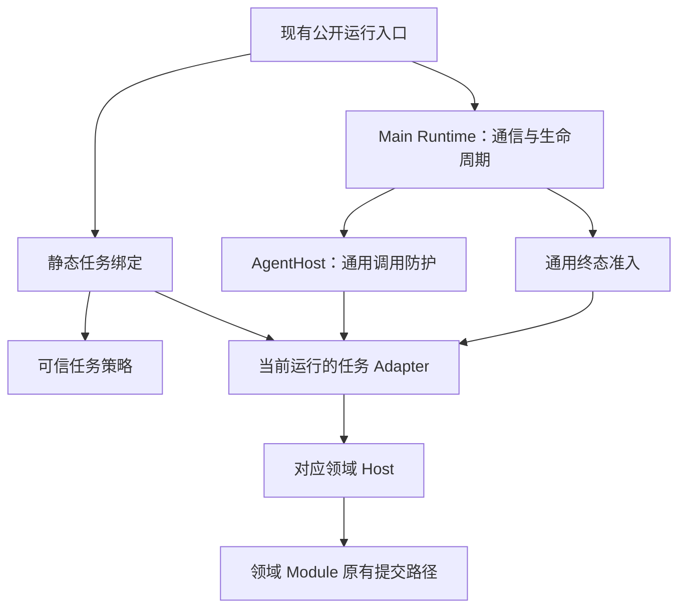

# Agent 通用运行层职责收窄计划

- 日期：2026-10-27
- 状态：已实施
- 范围：TypeScript 宿主运行层、任务协议适配及相关测试；保留 Python 图、现有公开运行接口和 JSONL 协议

## 目标

让通用运行层只处理进程通信、运行生命周期与通用安全防护，每次运行绑定一个明确的任务 Adapter。各任务的操作解析、执行顺序和完成回执核验集中在自己的 Adapter 中，领域 Host 继续持有内容、业务规则和提交语义。

完成后，新增任务仍需显式扩展协议、可信任务策略、任务 Adapter 和公开运行入口，但不再向通用调用处理与完成处理函数追加领域分支，也不再给每次运行附带多种可选 Host。

本计划已完成实施及相关验证。合法请求行为保持原样；对提前完成等非法协议路径统一拒绝，新增安全行为先通过失败测试复现，再完成修复。

## 实施前代码基线

| 位置                                     | 实施前职责与问题                                                                                                                                                       |
| ---------------------------------------- | ---------------------------------------------------------------------------------------------------------------------------------------------------------------------- |
| `src/core/agent/agent-host.ts`           | `AgentHost` 同时维护通用调用账本、词汇／短语索引、句子练习顺序、测试工具状态与模型对象；构造函数接收八类可选领域 Host。`call()` 混合白名单、预算、参数解析及任务分派。 |
| `src/main/agent/python-agent-runtime.ts` | `RunHosts` 维护八类可选 Host；`receive()` 通过 Host 是否存在推断并发、流事件权限和完成帧处理，各类终态重复调用 `verifyCompletion()`。                                  |
| `src/core/agent/agent-runtime.ts`        | 聚合公开运行接口和领域 Host 契约；`createAgentSnapshot()` 同时设置各任务权限、预算及上下文裁剪。并发策略另写在 Main 中。                                               |
| `src/core/learning/*/*-host.ts`          | 已有独立领域账本及完成核验；分别保留暂存、逐词事务、探索历史、练习结果等业务状态，适合继续作为任务 Adapter 的受控依赖。                                                |

现有代码的主要问题是任务知识分散于多个通用模块，并非缺少更多业务 Host。重构应收拢任务知识，避免将现有校验搬散或叠加新的领域状态机。

## 范围与相关计划

本次包含：

- 静态可信任务策略，集中现有权限、预算、宿主并发与事件模式。
- 按任务类型绑定的 Adapter，集中操作参数校验、任务特有前置条件与完成核验。
- `AgentHost` 的统一调用防护，以及 `PythonAgentRuntime` 的通用运行与终态处理。
- 行为、安全边界、故障与真实 Python 管道集成测试，以及职责文档同步。

本次不包含：

- Python 任务识别、Prompt、图、策略、图状态、补足与纠正轮次调整。
- TypeScript 领域模型、供应商传输、工具 Schema、事务、持久化格式或数据库迁移。
- Renderer、Preload、IPC、用户交互、国际化文本及公开 `AgentRuntime` 方法改名。
- JSONL 帧结构、Zod 协议、协议 v11、生成 Schema、握手或运行包启动／分发变更。
- 动态插件注册、字符串路径加载、任意工具执行接口、自动重试、失败重放或 TS Agent 回退。
- 拆分所有 `HostOperations` 类型、统一领域 Host 类层次，或建立跨语言任务配置生成框架。

与 [Python 工作流目录重构计划](2026-10-27-python-workflow-organization.md) 独立：本计划不修改 Python Server 的结果发送分支，也不要求先迁移 Python 目录。

与 [TypeScript 领域专属实现归位计划](2026-10-27-ts-domain-implementation-colocation.md) 独立：该计划只移动领域专属模型 Adapter、工具和测试，本计划新增的是宿主协议任务 Adapter。若连续实施，建议先完成领域文件归位，再落实本计划；若次序相反，后续只更新工具导入。不要并行修改同一 `AgentHost` 分支。

## 目标职责与依赖

| 模块                         | 负责                                                                                               | 不承担                                               |
| ---------------------------- | -------------------------------------------------------------------------------------------------- | ---------------------------------------------------- |
| Main 的 `PythonAgentRuntime` | 子进程协调、运行身份、调用归属、消息序号、队列、取消、截止、迟到帧、通用并发准入、终态清理         | 词项索引、练习轮次、工具参数、领域完成结果的逐类分派 |
| `AgentHost`                  | 调用白名单、重复调用拒绝、步骤与模型／非模型调用预算、统一输出计量、调用前后取消检查               | 根据任务名称选择业务分支，持有多种领域 Host          |
| 可信任务策略                 | 固定预算、允许操作、并发规则、流事件模式、预期成功完成帧                                           | Prompt、图决策、输入内容、凭据或存储                 |
| 任务 Adapter                 | 精确参数与回执 Schema、任务前置条件、实际输入预算检查、绑定索引／轮次校验、调用所属 Host、完成核验 | 改写 Prompt、增加模型调用或纠正轮次、提交业务存储    |
| 领域 Host 与 Module          | 既有内容账本、领域校验、模型传输、业务事务、结果提交与幂等                                         | 信任 Python 自报成功而跳过账本核验                   |



`core/agent` 不导入 Main、Electron 或具体数据库实现。任务 Adapter 只依赖现有 `HostOperations` 契约、协议 Schema、必要工具定义和通用模型接口；通过注入调用领域 Host，不直接构造领域 Module。`learning` 不反向导入具体任务 Adapter。

## 建议目录

```text
src/core/agent/
├── agent-runtime.ts             # 保留公开运行接口、错误类型与快照构造入口
├── agent-protocol.ts            # 保持协议唯一来源，内容不变
├── agent-host.ts                # 通用调用防护与计量
├── agent-task-policy.ts         # 静态、可信的任务权限及运行限制
├── agent-task.ts                # 内部任务绑定、调用计划、成功完成帧契约
├── agent-task-binding.ts        # 穷尽分支，绑定 task 与对应 Host／Adapter
├── tasks/
│   ├── conversation-task.ts     # 普通回复与独立标题；保持各自模式
│   ├── vocabulary-task.ts
│   ├── phrase-task.ts
│   ├── synonym-task.ts
│   ├── explore-phrase-task.ts
│   ├── explore-vocabulary-task.ts
│   ├── sentence-practice-task.ts
│   ├── vocabulary-practice-task.ts
│   ├── tts-task.ts
│   ├── tool-loop-task.ts        # 仅原有受控测试扩展
│   └── __tests__/
└── __tests__/

src/main/agent/
├── python-agent-runtime.ts      # 保留公开方法，内部每个 Run 只存当前绑定
├── python-agent-process.ts      # 启动、握手和进程实现保持原样
├── agent-transport.ts           # JSONL 传输保持原样
└── __tests__/
```

任务的 Schema 选择、操作分派、局部状态及完成核验在同一 Adapter 文件内，不再拆成逐操作小文件。`agent-task.ts` 只定义内部协作契约，不导入具体 Adapter；工厂单独静态导入各 Adapter，避免契约与实现的循环依赖。

公开 `runVocabulary()`、`runPhrase()`、`runSynonym()` 等方法和 `stream()` 保持现有签名。`HostOperations` 暂留在 `agent-runtime.ts`，相关模块优先使用类型导入，本次不扩大领域调用方迁移。

## 设计约定

### 1. 每次运行只绑定一种任务

- 内部绑定输入使用以 `task` 为判别字段的联合类型：每个批量任务必须且只能携带其对应 Host；普通对话与标题绑定模型依赖；测试工具任务必须携带原有测试扩展。
- 删除 `RunHosts` 及 `AgentHost` 的八个可选 Host 参数。不能以一个包含更多可选字段的对象替代。
- 绑定工厂使用显式、穷尽的静态分支；创建出的 Adapter 在该运行结束后丢弃，状态不得在两次运行之间复用。
- 运行输入、可信快照和 Adapter 的任务标识必须一致；绑定不匹配在启动 Python、请求模型或调用业务工具前失败。
- 生产装配不提供测试扩展时，`tool-loop` 无法构建可执行绑定。保留测试覆盖，不扩大协议已有枚举所代表的生产授权。
- 保留公开批量入口到当前任务的固定映射，以及协议要求的最小占位消息；本次不为批量任务修改消息 Schema。

### 2. 任务策略集中，但协议继续只有一个来源

策略中仅记录宿主运行所需的固定限制；任务、操作和完成帧类型直接引用现有协议类型。使用 TypeScript 的穷尽检查保证新增任务必须补充策略；不能另建可与 Zod 漂移的运行时 Schema。

`createAgentSnapshot()` 从可信策略复制预算和权限，再通过现有 `agentSnapshotSchema` 校验。Renderer、Python 帧和用户配置均不能覆盖策略；每次返回独立快照，调用方修改不能污染后续运行。

保留以下预算，单位为 UTF-16 单元，截止时间包含现有启动等待：

| task                                                  | 总截止 | 模型／非模型调用／步骤 | 输入／输出上限  |
| ----------------------------------------------------- | ------ | ---------------------- | --------------- |
| `conversation`、受控 `tool-loop`                      | 120 秒 | 3／2／16               | 32,768／32,768  |
| `conversation-title`                                  | 120 秒 | 1／0／1                | 32,768／80      |
| `vocabulary`、`phrase`                                | 180 秒 | 20／2／32              | 32,768／32,768  |
| `synonym`                                             | 180 秒 | 1040／1061／2200       | 65,536／524,288 |
| `explore-phrase`、`explore-vocabulary`                | 180 秒 | 3／1／8                | 65,536／32,768  |
| `sentence-practice-hints`、`sentence-practice-review` | 120 秒 | 1／1／2                | 65,536／1,024   |
| `vocabulary-practice-review`                          | 120 秒 | 8／10／18              | 65,536／4,096   |
| `tts`                                                 | 180 秒 | 0／1／1                | 4,096／1,024    |

表中的调用预算是上限，不代表图应耗尽该数量。供应商超时、词汇／短语分析窗口、近义词逐词限制及探索锁的截止起点仍由现有领域实现持有。

- 词汇仅允许两个 `model.vocabulary` 并行；短语仅允许两个 `model.phrase` 并行。`prepare` 或其他操作不能与未结束调用并行。
- 其余任务宿主调用串行。应用级同时运行最多 8 个、队列上限、取消宽限及 retired 运行保留规则保持原样。
- 策略明确区分接收流事件与只接收完成回执。批量任务拒绝 `event`；对话及测试扩展保留既有事件语义；标题仍忽略模型思考，只计正文。
- 成功完成帧对应关系为：对话／标题／测试扩展使用 `result`，其他任务使用现有对应的 `*_result`；句子提示与点评仍共用 `sentence_practice_result`。
- TS 策略是可信宿主的固定限制；Python 独立检查继续保留，不将两侧校验合并或删除。

### 3. 调用防护统一执行，任务校验保持集中

任务 Adapter 的内部协作面限定为两部分：准备一项经过校验的宿主调用，以及核验该任务的成功完成帧。当前任务策略随绑定提供，调用生命周期与累计计量由通用层持有。

调用顺序：

1. Main 校验运行／调用归属、重复 ID 与当前并发准入，登记未完成调用。
2. `AgentHost` 检查取消、白名单、重复调用、步骤限制和通用参数形状。
3. Adapter 校验操作专属 Schema、准备顺序、绑定索引／轮次及实际输入大小，返回待执行调用；这一步不能请求模型、执行业务工具或提交存储。
4. `AgentHost` 在任何实际调用前统一预留模型／非模型调用预算，再执行待执行调用。计数在 `await` 前完成，两个并行分析不能同时越过剩余预算。
5. Adapter 对所属 Host 的返回执行精确回执 Schema 和任务归属校验；通用层在返回前再次检查取消、累计输出和调用状态。
6. Main 发送既有 `host_result` 或流 chunk，并在调用结束后清理未完成记录；发送失败沿用现有运行失败路径，不重试调用。

预留预算失败后终止当前运行，不继续使用其局部状态。不要让 Adapter 通过传入任意字符串或另建调用入口绕过通用防护。错误类型、原因保留和校验优先级应以现有行为测试为准，不能因计量搬迁把非法索引等协议错误无意改为预算错误。

各 Adapter 原样收拢以下任务知识：

- 词汇／短语：准备结果快照、pending 索引、索引单次认领、Prompt + 绑定词项 JSON + 实际工具定义的输入计量、回执索引一致性。
- 句子练习：先准备、最多一次模型调用，以及提示与点评操作隔离。
- 近义词／两种探索／词汇练习：精确的操作与回执 Schema；继续由现有领域 Host 核验轮次、候选和完整消息，不在 Adapter 重建业务账本。
- 普通回复／标题：完整 Python Prompt 原样传递、实际历史输入检查、当前运行模型绑定、正文聚合及标题的思考过滤。
- TTS：空参数、唯一合成操作及完成回执；不解析原文、不解析音频、不解析模型配置。
- 测试工具循环：查询授权与既有工具结果一致性；只有受控测试依赖可以执行。

输出计量先记录基线再迁移，保留各任务当前口径：流 delta、决策正文或安全回执 JSON 分别计量；词汇／短语 `prepare` 结果当前不进入分析回执累计，不能顺便改变。不得对同一段流正文同时按 delta 和最终 `text` 重复扣预算。实际输入仍由任务 Adapter／领域 Host 根据完整请求验证，不能以跨管道占位消息代替。

### 4. 通用终态准入后，由当前 Adapter 核验完成

Main 对成功帧只执行通用准入并委托当前 Adapter，不再通过一组可选 Host 分支调用 `verifyCompletion()`：

1. 保留 instance／run 归属、retired 运行和迟到帧处理。
2. 校验成功完成帧类型与当前任务策略完全一致；错误和取消继续走通用失败分支。
3. 成功完成时必须没有未结束的宿主调用；流式任务还需满足原有事件序号、输出限制及最终正文一致性要求。
4. Adapter 调用对应领域 Host 的 `verifyCompletion()`；成功后通用层才标记运行成功，失败则沿用稳定安全错误及取消清理。
5. 运行完成只释放核验结果，不触发业务提交；现有 Module 继续在原有位置提交，保留提交阶段锁与等待实际存储完成的约定。

现有 TTS、句子练习及词汇练习已显式检查未完成调用，其他成功分支没有统一检查。本次补齐所有任务的成功准入：先用可控 Host／传输替身复现提前完成，再实现拒绝，并以正常真实管道用例验证不会把 `host_result` 发送与调用清理之间的调度误判为非法完成。

成功完成核验至多一次，终止后的回执不能重复释放结果。保留现有正文一致性；本次不新增成功帧字段或模型调用次数回执。

## 必须保持的领域行为

- 词汇／短语保留双并发、已有项跳过、超时报告和暂存结果；图完成核验后才统一提交内容及报告。
- 近义词保留跨会话串行批次、逐词事务及已提交词的结果；故障后仅由用户显式重试继续剩余词。
- 两种探索保留独立权限、锁、历史文件与恢复身份，三轮补足与最终 10 项要求不变；提交开始后等待实际存储结果再解锁。
- 句子练习不新增历史；词汇练习保留原有补标策略、错题保存、成功 requestId 缓存和保存重试幂等。
- TTS 继续使用零模型调用，核验后提交音频；历史播放读取既有音频，首次标题使用本地摘要。
- 普通对话、概念及独立标题保留流式、失败、取消和现有标题校验；TS 不新增概念命令识别或 Prompt 选择。
- 所有模型及非模型调用保留既有 signal、配置快照、用途与用量统计；不将 API Key、外层会话／消息 ID、完整内部内容发送到 Python 或 Renderer。
- 启动失败、协议错误和执行故障明确失败，不重放失败请求；后续显式新请求沿用现有引擎恢复方式。

## 实施步骤

### 1. 固定基线与补齐行为测试

- [x] 确认锁定 Python 环境同步，运行 Agent 单元测试和相关真实管道集成，记录既有合法行为。
- [x] 清点现有任务权限、预算、并发、事件、输出计量、完成帧和领域 `verifyCompletion()` 路径，形成下述行为测试矩阵。
- [x] 先为跨任务完成、未完成调用时提前成功、无测试授权执行工具循环补充公开入口测试；若已有覆盖则直接复用。
- [x] 对现有实现未满足的安全拒绝行为先确认测试因预期原因失败，再进行最小修复。纯职责搬迁复用现有测试，不逐个私有方法建立测试。

阶段验收：合法任务操作、结果和计量基线明确；安全收紧与纯重构有可区分的失败测试及改动。

### 2. 提取可信任务策略

- [x] 将现有预算与允许操作提取到 `agent-task-policy.ts`，补充当前散落在 Main 的并发、事件与预期完成帧规则。
- [x] 保留 `createAgentSnapshot()` 公共入口与 Unicode 安全裁剪，改为复制可信策略并调用原有 Zod schema 校验。
- [x] Main 先改为读取可信策略进行并发及事件准入，暂保留旧 Host 分派；不要同时重写进程启动、队列或取消机制。
- [x] 验证全部任务权限与快照等价、只裁剪运行副本、跨运行策略不受可变对象污染。

阶段验收：策略只有一个可信 TS 定义点；协议、实际限制及现有行为不变。

### 3. 建立任务绑定与 Adapter，逐组迁移

- [x] 定义内部判别联合、调用计划及完成核验契约，建立静态绑定工厂；错误任务／Host 组合编译期不可构造，运行入口仍校验任务一致性。
- [x] 先迁移 TTS，以零模型调用验证统一防护、完成核验与故障路径；随后迁移两种探索及句子练习。
- [x] 再迁移词汇／短语，重点保留双并发计数、索引单次认领、输入工具大小和输出计量。
- [x] 迁移近义词与词汇练习，保留领域 Host 原有轮次、决策授权及事务账本。
- [x] 最后迁移普通回复、标题及受控测试工具循环，保留流、思考过滤、模型绑定及最终正文一致性。
- [x] 每组同时更新对应公开运行方法、AgentHost 委托和成功核验路径；该组测试通过后再迁移下一组。可暂时保留“已迁移绑定／未迁移旧路径”的内部显式分支，不能对同一请求试两条路径或故障回退。

阶段验收：每组合法任务均只走一个执行路径；公开签名不变，错误与取消不会触发重放。

### 4. 收窄通用运行与清理旧分支

- [x] 删除 `RunHosts`、可选领域 Host 构造参数及 AgentHost 中的任务状态；每个 Run 只持有当前绑定与通用运行账本。
- [x] 统一成功帧分类、任务匹配、未完成调用检查和完成核验；Main 的通用接收函数不再逐任务选择领域 Host。
- [x] 保留 `host_call`、`event`、成功完成、`error`、`cancelled` 的协议处理分类，以及原有归属、顺序、队列、截止与取消清理。
- [x] 核验调用错误和 `verifyCompletion()` 异常仍进入现有安全失败路径；清除迁移用旧路径，不保留两套生产执行方式。
- [x] 更新 `agent-engine/README.md` 与 `docs/architecture.md` 的宿主职责说明，不改写现有 Python／TypeScript 分工。

阶段验收：通用调用和成功处理不再随任务增加而增长领域分支；任务差异全部可定位到策略、静态绑定及对应 Adapter。

### 5. 全量验证与交付

- [x] 执行下述检查，核验协议生成物无差异、所有现有任务仍经过真实 Python 管道。
- [x] 检查 Main 装配、领域调用方及已有受控测试入口的类型兼容；没有新增循环依赖或对 Main／数据库的反向导入。
- [x] 记录实施结果、测试覆盖、E2E 状态及未完成事项。全部计划工作与相关验证完成后，将本计划状态改为“已实施”。

## 测试与验证

### 行为测试矩阵

| 位置                                                    | 主要行为                                                                                                                 |
| ------------------------------------------------------- | ------------------------------------------------------------------------------------------------------------------------ |
| `src/core/agent/__tests__/agent-task-policy.test.ts`    | 全部任务的固定权限、预算、事件／完成类型与并发；快照复制及 Unicode 裁剪复用原有测试                                      |
| `src/core/agent/__tests__/agent-host.test.ts`           | 越权和重复调用零副作用、统一预算预留、并发下计数、取消前后检查、正确输出口径与稳定安全错误                               |
| `src/core/agent/tasks/__tests__/*.test.ts`              | 通过通用 AgentHost 调用真实任务 Adapter 与可控 Host，验证参数、顺序、绑定索引、Prompt 透传和完成核验；不直接断言私有字段 |
| `src/main/agent/__tests__/python-agent-runtime.test.ts` | 受控传输下的跨任务／提前终态、并发与串行、乱序事件、重复和迟到回执、取消、退出、发送失败；fixtures 留在对应测试目录      |
| `tests/integration/python-agent.test.ts`                | 真实握手、流输出、测试工具循环、启动失败、取消队列、取消宽限及关闭后迟到输出                                             |
| 既有各任务 `tests/integration/*-agent.test.ts`          | 全部生产任务的真实 JSONL 调用与完成核验；复用领域测试验证提交、独立锁、幂等与数据暴露范围                                |

补充重点场景：词汇／短语两个并发操作可以完成，第三个或混入准备操作必须失败；其他任务并行调用必须失败；标题不得调用 `model.reply` 或处理思考；TTS 不得解析模型；任一任务不能接受另一任务的成功完成帧；故障和取消后不产生额外模型／存储副作用。

协议替身测试与真实管道测试互补：替身用于构造非法顺序与竞态，真实 Python 用于证明正常调度、结果发送和调用清理仍兼容。模型使用可控替身，存储仅使用临时数据库或临时目录，不运行开发应用打开真实用户数据。

最终实施验证：

```sh
# 全量测试前确保锁定的 Python 环境已同步
pnpm agent:sync

# TypeScript、应用构建及真实 Python 管道集成
pnpm lint
pnpm typecheck
pnpm test
pnpm build

# 跨语言契约与宿主集成回归
pnpm agent:protocol
pnpm agent:test
pnpm agent:check
```

阶段内按受影响范围执行定向 Vitest 与类型检查；全量验证不因使用协议替身而跳过真实 Python 集成。生产协议、Python 源码及启动／分发不变，本计划不额外安排运行包构建；若实施扩大到这些部分，先补充范围并运行 `pnpm agent:build`、`pnpm agent:smoke`。不手改生成 Schema，也不为内部 TS 重构提升协议版本。

执行任何 E2E 前须另行取得用户明确许可；未获许可不执行、不作为阻塞项，交付注明“E2E 未执行，按约定默认无问题”。本次已执行上述实施验证；仅涉及 TS 内部职责重构及文档，未执行运行包构建。

## 验收标准与回退

- [x] 公开运行方法保持兼容；内部每次运行只绑定一个正确任务，不存在多种可选 Host 的组合。
- [x] 通用运行／调用模块保留集中安全防护，任务专属校验与完成核验在对应 Adapter 内可完整阅读。
- [x] TS 权限、预算、并发与事件规则有明确可信定义；Python 校验及 Zod 唯一协议来源保持原样。
- [x] 成功完成必须匹配当前任务、没有未结束调用并通过核验；取消、错误、重复及迟到帧不能重复释放或提交结果。
- [x] 全部现有生产任务、受控测试扩展、实际输入／输出计量、提交和恢复语义通过相关行为及真实管道测试。
- [x] 没有新生产回退路径、动态执行入口、协议或持久化格式变化；领域目录搬迁不被混入本次重构。
- [x] 文档、检查记录和实施状态与实际结果一致；计划状态在全部相关工作完成后更新为“已实施”。

每阶段保持可独立回退；回退代码时同时恢复同阶段的委托与绑定，避免保留双执行路径。回退不修改用户数据、不打开真实数据库，也不通过自动重放请求验证恢复。

## 实施结果与验证记录

2026-10-27，在分支 `feature/agent-runtime-responsibility-narrowing` 完成：

- `agent-task-policy.ts` 集中全部 12 种任务的权限、预算、并发、事件和成功帧规则；策略与快照按运行复制，保留 Unicode 安全裁剪。
- `agent-task.ts` 定义调用计划与 Adapter 契约，`agent-task-binding.ts` 通过判别联合及静态穷尽分支注入唯一依赖；新增 10 个 Adapter 文件覆盖所有生产任务和受控测试扩展。
- `AgentHost` 从 453 行收窄为 78 行，集中调用防护、取消检查、调用预算预留与输出计量；任务内容、局部索引和模型实例归各 Adapter 持有。
- `PythonAgentRuntime` 删除 `RunHosts`，统一完成帧准入及 Adapter 核验，保留原有进程、队列、取消和退役运行处理。提前完成及未安装测试扩展的入口均先记录预期失败，再修复通过。
- 新增策略／快照隔离、绑定类型与运行一致性、Adapter 参数和回执、并发预算、完成帧、流序号、取消、退出、发送失败和迟到结果测试。保留领域 Host 与 Module 的事务、锁、提交和恢复路径。
- 同步 `agent-engine/README.md` 和 `docs/architecture.md`。没有改动 Python 源码、协议 v11、生成 Schema、持久化格式或 Renderer／IPC 接口，也未打开真实用户数据库。

| 验证                            | 结果                                                                |
| ------------------------------- | ------------------------------------------------------------------- |
| `pnpm agent:sync`               | 锁定环境同步成功；沙箱中使用临时 `UV_CACHE_DIR`                     |
| 重构前 Agent 单元及真实管道基线 | 12 个文件、351 个测试通过                                           |
| `pnpm lint`                     | 通过                                                                |
| `pnpm typecheck`                | Node 与 Web 均通过                                                  |
| `pnpm test`                     | 178 个文件、2029 个测试全部通过，包含全部现有任务的真实 Python 管道 |
| `pnpm build`                    | 通过                                                                |
| `pnpm agent:protocol`           | 通过，协议生成物无差异                                              |
| `pnpm agent:test`               | 378 个测试全部通过                                                  |
| `pnpm agent:check`              | Ruff 检查／格式与严格 mypy 均通过                                   |
| `git diff --check`              | 通过                                                                |

首次全量测试中，3 个使用本地假模型服务的集成测试受沙箱 `listen EPERM 127.0.0.1` 限制；允许本地监听后重跑完整 `pnpm test`，全部通过。没有削弱测试或跳过失败用例。

E2E 未执行，按约定默认无问题。未启动开发应用；无未完成事项。生产启动／分发和 Python 图未变，因此本计划不要求额外运行 `agent:build`、`agent:smoke`。
