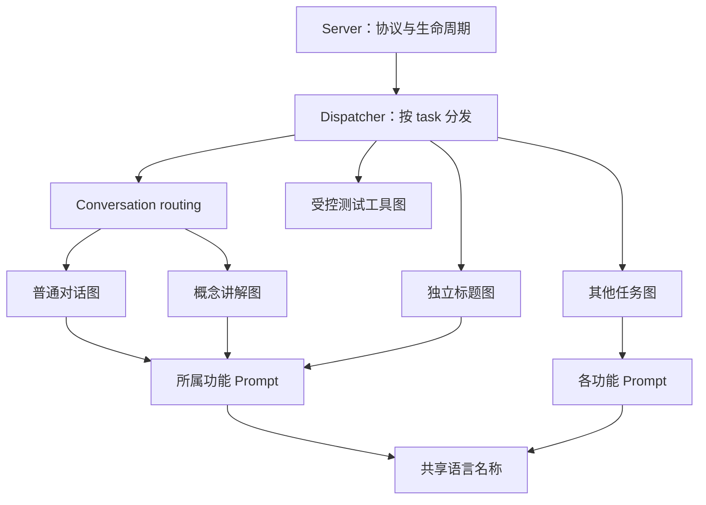

# Python Agent 任务分发与工作流目录重构计划

- 日期：2026-10-27
- 状态：待实施
- 范围：Python 内部结构重构，保持现有任务、Prompt、图行为及跨语言协议

## 目标

将任务分发从 `graphs/learning.py` 拆出，按功能收拢 LangGraph 图与 Prompt。完成后，维护者可以从固定入口找到任务，再进入对应功能目录阅读图、节点、状态和指令；普通对话图只表达对话执行流程。

本次交付为实施计划，尚未进行代码迁移。实施时按可独立验证的步骤推进，避免把目录迁移与策略变更混在同一步中。

## 当前代码基线

| 位置                                              | 当前职责                                              | 调整原因                                       |
| ------------------------------------------------- | ----------------------------------------------------- | ---------------------------------------------- |
| `agent-engine/src/lingo_agent/graphs/learning.py` | 所有任务分发、`/concept` 识别、普通回复、测试工具循环 | 文件名不能表达全局入口，同时包含三种不同职责   |
| `agent-engine/src/lingo_agent/prompts.py`         | 各任务 Prompt、语言名称、概念命令匹配                 | 一个功能的图与指令分离，命令识别和文本生成混放 |
| `agent-engine/src/lingo_agent/graphs/*.py`        | 各功能的图、节点及大部分任务状态                      | 已有明确功能划分，适合保留并与 Prompt 放在一起 |
| `agent-engine/src/lingo_agent/graphs/common.py`   | HostCall、限制错误、字符预算、共享回复及初态          | 迁移至工作流公共位置，先保持现有行为           |
| `agent-engine/src/lingo_agent/state/__init__.py`  | 对话、概念、标题及测试工具图共享的 LearningState      | 保留现有共享状态，本次不重设计状态结构         |
| `agent-engine/src/lingo_agent/runtime/server.py`  | JSONL、运行与调用归属、取消、错误转换、完成帧发送     | 改为调用独立分发入口，并更新图状态的导入路径   |

目前有 11 个实际构建 `StateGraph` 的模块；`learning.py` 内还混合普通回复与测试工具图。拆分后保留各自的执行语义，文件数量不作为验收目标。

## 范围与约束

本次实施包括：

- 独立 Python 任务分发入口，迁移现有全部任务分支。
- 按功能放置图与 Prompt，区分普通对话、概念讲解、标题和测试工具循环。
- 更新 Python 测试、运行服务、文档及构建引用；验证开发解释器与冻结运行包。

本次不包含：

- TypeScript 领域目录搬迁、`AgentHost` 或 Main Runtime 的职责重划。
- 通用图模板、动态插件注册、统一所有任务执行签名、共享并发或补足流程的抽象。
- Prompt 改写、工具策略或预算调整、新增任务、记忆、checkpoint、跨运行 Store。
- JSONL 帧结构、协议版本、Zod schema 或业务数据库迁移。

Python 继续持有 Agent 策略、Prompt 和图；模型凭据、供应商请求、业务校验及持久化继续由 TypeScript 宿主持有。两端现有校验均保留。

## 目标目录

以下路径相对于 `agent-engine/src/lingo_agent/`；新增包目录使用最小 `__init__.py`，其中不承载注册、执行或批量重导出逻辑。

```text
lingo_agent/
├── __init__.py
├── __main__.py
├── runtime/
│   ├── dispatcher.py          # 固定 task 到工作流入口的分发
│   └── server.py              # JSONL 与运行生命周期
├── workflows/
│   ├── __init__.py
│   ├── common.py              # 原 graphs/common.py，共享检查与回复辅助
│   ├── language.py            # 仅 language_name
│   ├── conversation/
│   │   ├── __init__.py
│   │   ├── routing.py         # 最新消息的 /concept 识别与会话内选择
│   │   ├── graph.py           # START → reply → END
│   │   ├── concept.py         # START → explain → END
│   │   ├── title.py           # 独立 conversation-title 任务
│   │   └── prompts.py         # 对话、概念、标题 Prompt
│   ├── vocabulary/
│   │   ├── __init__.py
│   │   ├── graph.py
│   │   └── prompts.py
│   ├── phrase/
│   │   ├── __init__.py
│   │   ├── graph.py
│   │   └── prompts.py
│   ├── synonym/
│   │   ├── __init__.py
│   │   ├── graph.py
│   │   └── prompts.py
│   ├── explore_phrase/
│   │   ├── __init__.py
│   │   ├── graph.py
│   │   └── prompts.py
│   ├── explore_vocabulary/
│   │   ├── __init__.py
│   │   ├── graph.py
│   │   └── prompts.py
│   ├── sentence_practice/
│   │   ├── __init__.py
│   │   ├── graph.py            # 提示与点评仍共享当前图实现
│   │   └── prompts.py
│   ├── vocabulary_practice/
│   │   ├── __init__.py
│   │   ├── graph.py
│   │   └── prompts.py
│   ├── tts.py                  # 保持单文件，无模型 Prompt
│   └── tool_loop.py            # 原有受控测试扩展图
├── state/
│   └── __init__.py             # 保留现有 LearningState
├── protocol/                  # 协议解析与生成 schema，保持原位置
└── __tests__/                 # 保持项目约定的 Python 测试位置
```

节点函数和各任务自身的 `TypedDict` 状态继续与图连接定义放在同一文件。只有对话、概念、标题共享一个功能目录；词汇与词汇探索、短语与短语探索仍是独立任务目录。测试工具图留在可打包源码中，不从 `__tests__/` 导入实现。

## 职责与依赖



### 任务分发

`runtime/dispatcher.py` 提供统一的 `execute(run_id, snapshot, host)` 入口，保留当前调用约定及具体状态类型的返回联合。分发采用明确的任务分支与普通静态导入，使任务列表可阅读、可检查并可被 PyInstaller 发现。

分发器只选择现有工作流并等待执行结果，不构建图、不生成 Prompt、不调用模型、不修改权限和预算。各图函数保留原有参数约定，由分发器按需要传递 `run_id`；不为形式统一添加多余包装。

| 输入 task                    | 目标入口                                     | 对外完成帧                   |
| ---------------------------- | -------------------------------------------- | ---------------------------- |
| `conversation`               | `conversation/routing.py` → 普通对话或概念图 | `result`                     |
| `conversation-title`         | `conversation/title.py`                      | `result`                     |
| `vocabulary`                 | `vocabulary/graph.py`                        | `vocabulary_result`          |
| `phrase`                     | `phrase/graph.py`                            | `phrase_result`              |
| `synonym`                    | `synonym/graph.py`                           | `synonym_result`             |
| `explore-phrase`             | `explore_phrase/graph.py`                    | `explore_phrase_result`      |
| `explore-vocabulary`         | `explore_vocabulary/graph.py`                | `explore_vocabulary_result`  |
| `sentence-practice-hints`    | `sentence_practice/graph.py`                 | `sentence_practice_result`   |
| `sentence-practice-review`   | `sentence_practice/graph.py`                 | `sentence_practice_result`   |
| `vocabulary-practice-review` | `vocabulary_practice/graph.py`               | `vocabulary_practice_result` |
| `tts`                        | `tts.py`                                     | `tts_result`                 |
| `tool-loop`（受控测试扩展）  | `tool_loop.py`                               | 既有 text 事件与 `result`    |

未知 task 在任何宿主调用前明确失败，通过既有错误转换返回 `AGENT_PROTOCOL_ERROR`。生产协议已拒绝未知 task；新分发器保持这一明确拒绝，不沿用内部函数末尾的隐式普通回复分支。

### 会话内路由

`conversation/routing.py` 持有概念命令匹配和会话内图选择；全局分发器仅将 `conversation` 交给该入口。`conversation/graph.py` 只保留普通 `reply` 节点。

概念匹配函数及 `COMMAND_WHITESPACE` 从原 `prompts.py` 原样迁移，保持如下行为：

- 只判断最新一条消息，且该消息必须是 `user`。
- 保留 `/concept` 的大小写、词边界、空命令、BOM 及 ECMAScript 空白规则。
- 历史中的概念命令不会让普通追问继续粘连概念图。
- `conversation-title` 使用独立任务入口，不参与概念识别。

### Prompt 归属

保留全部工厂函数名称、参数、返回文本和 Prompt 版本标识，只改变模块位置：

| 目标文件                                   | 原有函数                                                                                          |
| ------------------------------------------ | ------------------------------------------------------------------------------------------------- |
| `workflows/language.py`                    | `language_name`                                                                                   |
| `workflows/conversation/prompts.py`        | `conversation_system_message`、`word_concept_system_message`、`conversation_title_system_message` |
| `workflows/vocabulary/prompts.py`          | `vocabulary_system_message`                                                                       |
| `workflows/phrase/prompts.py`              | `phrase_system_message`                                                                           |
| `workflows/synonym/prompts.py`             | `synonym_system_message`                                                                          |
| `workflows/explore_phrase/prompts.py`      | `explore_phrase_system_message`                                                                   |
| `workflows/explore_vocabulary/prompts.py`  | `explore_vocabulary_system_message`                                                               |
| `workflows/sentence_practice/prompts.py`   | `sentence_practice_hints_system_message`、`sentence_practice_review_system_message`               |
| `workflows/vocabulary_practice/prompts.py` | `vocabulary_practice_review_system_message`、`vocabulary_practice_marks_required_message`         |

各图直接导入所属功能的 Prompt。语言名称是共享纯函数；命令匹配留在会话路由。Prompt 模块不导入图、分发器或运行服务，避免循环依赖。

### 运行服务与公共代码

`Server.run()` 改为调用新分发入口，更新状态类型及 `LimitError` 的导入。现有逐任务完成帧适配继续留在 Server，保留帧类型、字段、事件顺序、错误映射及取消清理；本次不引入统一结果包装或改写发送机制。

`graphs/common.py` 原样迁为 `workflows/common.py`，保留当前回复预算检查、UTF-16 计数和初态生成。`LearningState` 保持当前位置与字段；其余任务已有的局部状态保持随图迁移。公共代码的进一步拆分独立评估。

旧 `graphs/` 和根 `prompts.py` 在全部调用方迁移后删除，不长期保留兼容重导出。迁移期间的临时兼容文件必须在同一实施阶段清理完成。

## 必须保持的可观察行为

- 所有任务只调用原有白名单操作，参数、绑定索引、轮次、完成回执及原文暴露范围不变。
- 全部 Prompt 在相同入参下返回逐字一致的文本，包含空白、换行、语言要求和补标指令；Prompt 版本不变。
- 普通对话、概念及标题保持各自的单次模型调用；单节点图保留终止调度轮次与实际操作步数的区别。
- 词汇与短语保留双 worker、已有项和重复项跳过、同伴取消及原有错误类型传播；不合并两种图。
- 近义词保留逐词顺序、多轮工具与纠正流程、52 轮上限和逐词提交后的结果保留。
- 两种探索分别保留最多三轮补足、10 项完成要求，以及宿主持有的独立权限、锁、历史与原子提交。
- 句子练习保留提示／点评隔离；词汇练习批改保留八轮和最多两次补标；TTS 保留零模型调用。
- 不改变 JSONL stdout、流事件、运行归属、并发上限、总截止、取消、迟到回执处理与失败不自动重放的约定。
- `tool-loop` 保留现有测试能力和预算；TS 的受控测试注入仍是其宿主操作的授权条件，目录拆分不扩大生产权限。

## 实施步骤

### 1. 建立重构基线

- [ ] 同步锁定 Python 环境，运行现有 Python 行为与静态检查，记录基线结果。
- [ ] 清点旧模块的全部导入和 README 中的源码路径，确认 Python 测试、Server、构建及真实管道用例的引用。
- [ ] 在生产代码移动前，为全部 Prompt 工厂与现有支持的语言组合保存固定输出基线；对话类同时覆盖独立学习语言。基线不从新旧工厂互相生成，不保留旧生产实现作为比对源。
- [ ] 复用现有概念路由、单步预算、取消、双 worker 和各任务图的行为测试；补充缺失的可观察行为，不为每条导入或目录结构新增快照测试。

不改变行为的搬迁复用既有测试。未知 task 的直接调用拒绝属于补充的内部入口约束，在步骤 2 先添加失败用例，再实现拒绝；迁移中发现的其他行为缺口也按 TDD 逐项处理。

### 2. 分离任务分发、对话和测试工具图

- [ ] 提取 `runtime/dispatcher.py`，建立上述显式 task 分支；未知 task 在宿主调用前失败。
- [ ] 将普通对话节点迁至 `workflows/conversation/graph.py`，概念图及标题图迁至对应目录。
- [ ] 提取 `conversation/routing.py`，迁移命令匹配与最新消息路由行为。
- [ ] 将测试专用 `decide ↔ tool` 图迁至 `workflows/tool_loop.py`，保持预算、结果和事件语义。
- [ ] 更新 Server 为新分发入口；公共辅助函数迁至 `workflows/common.py`，同步更新所有现有图和测试对公共辅助函数的导入，保证未搬迁的任务仍可运行。
- [ ] 将路由测试和工具循环测试职责区分，测试文件仍在根 `__tests__/`，通过真实入口与可控 host 验证结果，不 mock 分发器内部函数证明路由。

阶段验收：普通对话、概念、标题及工具循环的操作序列、输出、预算、失败与取消均通过；其余任务仍可通过分发入口运行。

### 3. 逐功能迁移图和 Prompt

- [ ] 先完成对话／概念／标题的 Prompt 聚合，再按词汇／短语、近义词、两种探索、句子练习、词汇练习批改、TTS 的顺序迁移；每组先保证其定向测试通过，再进入下一组。
- [ ] 同步迁移各 Prompt 工厂；将语言名称归入 `workflows/language.py`，清除命令匹配在 Prompt 中的旧定义。
- [ ] 保持各图的节点、边、条件分支、计数、闭包、任务状态、`compile().ainvoke()` 与 `recursion_limit` 原样。
- [ ] 更新分发器、Server 状态类型、测试及所有源码引用，删除旧 `graphs/`、根 `prompts.py` 与临时重导出。
- [ ] 保留 Python 测试发现规则，按职责调整测试名称或内容，测试 fixtures 留在 `__tests__/` 中。

阶段验收：全部 Prompt 固定输出基线一致；每个任务经新入口执行成功及失败用例；不存在指向已删除模块的有效源码引用。

### 4. 文档与冻结运行包验证

- [ ] 更新 `agent-engine/README.md` 的入口、目录图与各功能源码路径；检查 `docs/architecture.md` 中相关说明，保持现行职责约定。
- [ ] 保持 `__main__.py`、协议资源位置和启动方式稳定；检查 PyInstaller 对所有新模块的发现情况，使用正常导入，不使用字符串路径加载。
- [ ] 重建目标 OS/CPU 原生运行包并执行空 PATH 烟测，验证新路径下所有任务均被打包。现有烟测缺少的任务只补充模块可达性及原有协议行为验证。
- [ ] 确认 schema、协议 v11、握手能力与 manifest 的协议字段未变化；发布时仍携带本次源码构建的运行包。
- [ ] 执行下述验证，记录环境、命令、结果和实际平台覆盖；全部工作与要求的验证结束后，将计划状态更新为“已实施”。

## 验证方案

### Python 行为

| 覆盖项     | 验证方式                                                                           |
| ---------- | ---------------------------------------------------------------------------------- |
| 任务分发   | 每个支持 task 调用正确白名单操作并返回既有结果形状；未知 task 零宿主调用且明确失败 |
| 会话路由   | 复用空命令、BOM、空白、大小写、非 user、历史命令和普通追问用例；标题不触发概念路由 |
| Prompt     | 所有工厂、支持语言和补标指令与迁移前固定输出一致，保留显式解释／学习语言           |
| 有界执行   | 复用权限、UTF-16 输入输出、调用次数、步数和图终止轮次测试                          |
| 并发与多轮 | 复用双 worker 上限、同伴取消、近义词顺序、探索补足、词汇练习轮次测试               |
| 失败与取消 | 宿主错误保持原错误类型，不启动后续操作，不重试失败调用                             |

新增分发器用例放在 `agent-engine/src/lingo_agent/__tests__/test_dispatcher.py`。图级用例直接测试对应图；需要验证任务选择、命令识别的用例通过分发入口执行。现有 `test_learning_graph.py` 按职责整理为对话与工具循环测试，避免继续以 learning 命名全局入口。

### 真实管道与分发

复用 `tests/integration/python-agent.test.ts`、标题与各任务的 `*-agent.test.ts`，覆盖开发解释器的握手、流事件、任务回执、宿主失败、取消、迟到回执及恢复。现有宿主和领域集成测试继续验证提交语义；不新增真实模型调用，不访问真实用户数据库。

```sh
# 首次准备环境或执行 TypeScript 全量测试前确认已同步
pnpm agent:sync

# Python 与跨语言契约
pnpm agent:protocol
pnpm agent:test
pnpm agent:check

# 应用检查与真实 Python 管道集成测试
pnpm lint
pnpm typecheck
pnpm test
pnpm build

# 目录迁移后的原生运行包
pnpm agent:build
pnpm agent:smoke
```

本次不修改 Zod schema 或生成的 `protocol/schema.json`，`agent:protocol` 用于确认二者仍同步。PyInstaller 构建必须在实际目标 OS/CPU 上进行；记录已测平台，其他平台留待对应发布环境验收，不以本机烟测代替跨平台结论。

Electron E2E 遵循项目许可规则：仅在用户明确许可后执行 `pnpm test:electron` 或其他 E2E 命令。未获许可时不执行，不作为阻塞项，交付说明写明“E2E 未执行，按约定默认无问题”。当前只编写 Markdown 计划，检查文档和差异即可，不运行上述实施命令。

## 完成标准与回退

- [ ] 独立分发器是 Server 的任务执行入口，普通对话图只表达单次回复；概念选择集中于会话路由。
- [ ] 每个功能的图和 Prompt 在同一目录；无单节点文件进一步细拆，无跨功能 Prompt 总文件。
- [ ] `graphs/` 和旧 `prompts.py` 已删除，所有有效导入、测试和文档引用已更新。
- [ ] Prompt、白名单操作、任务返回形状、错误、取消、预算及提交语义保持上述约定。
- [ ] Python、TypeScript、真实管道、当前验证平台的冻结包检查均完成，并如实记录 E2E 与平台覆盖。
- [ ] 仅提交源代码、测试与文档，不提交运行包生成物；计划状态为“已实施”。

实施按步骤形成可回退的改动，失败时回退对应代码迁移并修复，不通过恢复 TS Agent 直跑、静默降级或重放请求规避问题。本次没有持久化结构变更，回退不涉及用户数据迁移。
