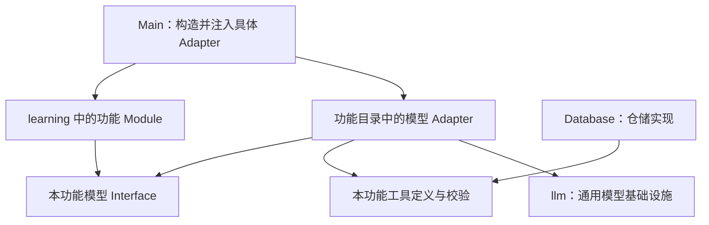

# TypeScript 领域专属实现归位计划

- 日期：2026-10-27
- 状态：已实施
- 范围：将 TypeScript 领域专属模型适配器、工具定义与测试归入对应的 `src/core/learning/` 功能目录，保持现有行为与协议

## 目标

维护一个学习功能时，可以在同一目录找到领域接口、宿主、模型适配器、工具定义、校验及单元测试。`src/core/llm/` 集中维护跨功能的模型基础设施，减少基础设施目录对学习功能类型、错误和工具的反向依赖。

本次实施以文件搬迁、导入更新及文档同步为主，复用现有接口和依赖注入，不重划 Agent 执行职责。实施记录与验证结果见文末。

## 实施前代码基线

实施前，9 个领域专属文件位于 `src/core/llm/`，5 个领域专属文件位于 `src/core/tools/`；对应的 7 个模型适配器测试和 2 个工具测试也位于这两个目录。它们覆盖 7 个已有学习功能目录。

| 当前位置                                                                                   | 已有依赖或职责                                        | 调整原因                                               |
| ------------------------------------------------------------------------------------------ | ----------------------------------------------------- | ------------------------------------------------------ |
| `core/llm/llm-explore-phrase-generator.ts`、`llm-explore-vocabulary-generator.ts`          | 依赖各自的候选类型、用户数据组装、领域错误及工具定义  | 一个探索功能的实现分散在 `learning/`、`llm/`、`tools/` |
| `core/llm/llm-vocabulary-analyzer.ts`、`llm-phrase-analyzer.ts`、`llm-synonym-analyzer.ts` | 实现领域模型接口，选择该领域工具并转换领域错误        | 具体领域 Adapter 与通用传输混放                        |
| `core/llm/llm-sentence-practice-*.ts`、`llm-vocabulary-practice-reviewer.ts`               | 处理练习专属输出和错误                                | 只有所属练习使用，适合随功能维护                       |
| `core/tools/*.ts`                                                                          | 专属工具 Schema、参数校验及近义词／词汇练习工具执行器 | 含明确领域规则，不是跨领域工具基础设施                 |
| `core/learning/vocabulary/vocabulary-insert.ts`                                            | 已在词汇目录内维护工具定义与内容校验                  | 可作为本次功能聚合的既有参照，无须额外移动             |

其中 `llm-sentence-practice-completion.ts` 虽被提示生成和点评共用，但它依赖 `SentencePracticeError`，仅服务句子练习；归入 `sentence-practice/`，不因此提升为通用模型基础设施。

## 范围与约束

本次实施包括：

- 搬迁下表列出的 14 个生产文件及 9 个测试文件，保持文件名、导出名称和现有调用约定。
- 更新 Main 装配、Agent 宿主、领域代码、数据库实现及集成测试的全部有效导入。
- 同步目录职责说明，清除失效路径和搬迁期间的临时兼容文件。

本次不包含：

- Python 工作流、Prompt、任务识别和 LangGraph 图调整。
- `AgentHost`、`PythonAgentRuntime` 的任务 Adapter 重设计，或权限、预算、并发规则调整。
- 通用模型接口、供应商传输、工具协议解析、用量枚举的重设计。
- 领域模型、业务规则、工具 Schema、持久化格式或数据库迁移。
- Renderer、Preload、IPC、国际化资源和用户交互变更。
- 新增目录索引导出、动态注册、通用工具框架或跨领域共享抽象。

本计划与 [Python 工作流目录重构计划](2026-10-27-python-workflow-organization.md) 可独立实施；该计划是否落地不作为本次搬迁的前置条件。

## 目标职责与依赖

| 位置                        | 保留或收拢的职责                                                                   |
| --------------------------- | ---------------------------------------------------------------------------------- |
| `src/core/learning/<功能>/` | 领域接口、规则、宿主、具体模型 Adapter、专属工具及对应测试                         |
| `src/core/llm/`             | 模型配置、通用客户端、供应商传输、流式处理、用量、连接测试和通用工具请求／响应处理 |
| `src/core/agent/`           | 跨语言协议、运行接口、宿主授权及预算校验；本次只更新必要的导入                     |
| `src/main/`                 | 读取可信配置、构造并注入具体 Adapter、进程和 IPC 装配；本次只更新必要的导入        |
| `src/database/`             | SQLite 连接、事务和仓储实现；仍可依赖领域内容类型及校验                            |
| `src/shared/`               | 跨进程共享的纯类型、常量和可序列化数据约束；保持既有位置                           |



该图说明文件归属和依赖关系，不新增执行路径。Main 仍沿用现有 Python 运行入口装配；具体 Adapter 只执行由既有宿主绑定的模型调用。领域 Module 继续通过已有 Interface 接收依赖，不因文件靠近就自行构造具体模型 Adapter。

`core/llm/` 迁出上述专属文件后，生产文件不再依赖 `core/learning/` 中的功能类型、错误或实现。通用 `tool-protocol.ts` 与 `tool-request-policy.ts` 继续留在 `llm/`，由各领域 Adapter 调用。

当前 `core/tools/` 中的 5 个生产文件全部迁出后，清理空目录及原测试目录，不添加占位文件，也不保留旧路径重导出。以后确有跨领域工具能力时，再根据实际职责决定其位置。

## 生产文件搬迁清单

下表路径相对于 `src/core/`。保留 `llm-` 文件名前缀，明确区分领域 Interface 与模型 Adapter，避免同时进行命名重构。

| 原路径                                        | 目标路径                                                             |
| --------------------------------------------- | -------------------------------------------------------------------- |
| `llm/llm-vocabulary-analyzer.ts`              | `learning/vocabulary/llm-vocabulary-analyzer.ts`                     |
| `llm/llm-phrase-analyzer.ts`                  | `learning/phrase/llm-phrase-analyzer.ts`                             |
| `llm/llm-synonym-analyzer.ts`                 | `learning/synonym/llm-synonym-analyzer.ts`                           |
| `llm/llm-explore-phrase-generator.ts`         | `learning/explore-phrase/llm-explore-phrase-generator.ts`            |
| `llm/llm-explore-vocabulary-generator.ts`     | `learning/explore-vocabulary/llm-explore-vocabulary-generator.ts`    |
| `llm/llm-sentence-practice-hint-generator.ts` | `learning/sentence-practice/llm-sentence-practice-hint-generator.ts` |
| `llm/llm-sentence-practice-reviewer.ts`       | `learning/sentence-practice/llm-sentence-practice-reviewer.ts`       |
| `llm/llm-sentence-practice-completion.ts`     | `learning/sentence-practice/llm-sentence-practice-completion.ts`     |
| `llm/llm-vocabulary-practice-reviewer.ts`     | `learning/vocabulary-practice/llm-vocabulary-practice-reviewer.ts`   |
| `tools/phrase-tools.ts`                       | `learning/phrase/phrase-tools.ts`                                    |
| `tools/synonym-tools.ts`                      | `learning/synonym/synonym-tools.ts`                                  |
| `tools/explore-phrase-tools.ts`               | `learning/explore-phrase/explore-phrase-tools.ts`                    |
| `tools/explore-vocabulary-tools.ts`           | `learning/explore-vocabulary/explore-vocabulary-tools.ts`            |
| `tools/vocabulary-practice-tools.ts`          | `learning/vocabulary-practice/vocabulary-practice-tools.ts`          |

以探索短语为例，完成后目录包含：

```text
src/core/learning/explore-phrase/
├── explore-phrase-conversation-skill.ts
├── explore-phrase-error.ts
├── explore-phrase-generator.ts          # 原有 Interface 与用户数据组装
├── explore-phrase-history-store.ts
├── explore-phrase-host.ts
├── explore-phrase-lock.ts
├── explore-phrase-module.ts
├── explore-phrase-table.ts
├── explore-phrase-tools.ts              # 迁入：专属 Schema 与工具定义
├── llm-explore-phrase-generator.ts      # 迁入：具体模型 Adapter
├── normalize-explore-phrase.ts
└── __tests__/
    ├── llm-explore-phrase-generator.test.ts
    └── 既有领域测试
```

不额外引入 `adapters/`、`schemas/` 或 `tools/` 子目录；当前规模下使用现有功能目录即可。共享取消辅助、共享探索锁、共享表格逻辑及 `core/prompt/language-name.ts` 保持原位置，不复制到各功能。

## 测试搬迁清单

下表路径相对于 `src/core/`。只改变文件位置和必要导入，保留既有用例及文件名。

| 原路径                                                       | 目标路径                                                                            |
| ------------------------------------------------------------ | ----------------------------------------------------------------------------------- |
| `llm/__tests__/llm-vocabulary-analyzer.test.ts`              | `learning/vocabulary/__tests__/llm-vocabulary-analyzer.test.ts`                     |
| `llm/__tests__/llm-phrase-analyzer.test.ts`                  | `learning/phrase/__tests__/llm-phrase-analyzer.test.ts`                             |
| `llm/__tests__/llm-synonym-round.test.ts`                    | `learning/synonym/__tests__/llm-synonym-round.test.ts`                              |
| `llm/__tests__/llm-explore-phrase-generator.test.ts`         | `learning/explore-phrase/__tests__/llm-explore-phrase-generator.test.ts`            |
| `llm/__tests__/llm-explore-vocabulary-generator.test.ts`     | `learning/explore-vocabulary/__tests__/llm-explore-vocabulary-generator.test.ts`    |
| `llm/__tests__/llm-sentence-practice-hint-generator.test.ts` | `learning/sentence-practice/__tests__/llm-sentence-practice-hint-generator.test.ts` |
| `llm/__tests__/llm-sentence-practice-reviewer.test.ts`       | `learning/sentence-practice/__tests__/llm-sentence-practice-reviewer.test.ts`       |
| `tools/__tests__/synonym-tools.test.ts`                      | `learning/synonym/__tests__/synonym-tools.test.ts`                                  |
| `tools/__tests__/vocabulary-practice-tools.test.ts`          | `learning/vocabulary-practice/__tests__/vocabulary-practice-tools.test.ts`          |

`llm-sentence-practice-completion.ts` 当前由提示／点评测试间接覆盖；词汇练习模型 Adapter 由领域与真实管道集成用例覆盖。本次不为了文件数量一致新增镜像测试。若迁移前发现行为覆盖缺口，先补充通过公开 Interface 验证的行为用例。

`tests/integration/` 下的跨模块测试、fixtures 和服务器保持原位置，只更新引用。当前 Vitest 的 `src/**/__tests__/**/*.test.{ts,tsx}` 及 `tests/integration/**/*.test.{ts,tsx}` 已覆盖目标位置，无须因搬迁修改测试发现配置。

## 调用方更新清单

- **Main 装配**：更新 `src/main/index.ts` 中 8 个具体模型 Adapter 的导入，保留工厂、参数、超时及注入关系。
- **诊断类型**：`VocabularyAnalysisFailure` 随 `llm-vocabulary-analyzer.ts` 移动，更新 `src/main/ai-import-failure-log.ts` 的类型导入；本次不改诊断结构和日志处理。
- **Agent 任务 Adapter**：更新 `src/core/agent/tasks/phrase-task.ts` 对 `phraseInsertTools` 的引用（实施时该引用已从 `agent-host.ts` 归入任务 Adapter）；保留现有预算计算和各任务操作校验。
- **领域文件**：更新短语 Host／Analyzer／Repository、近义词 Host、两种探索 Host 及词汇练习 Host 对专属工具的引用。
- **数据库实现**：更新 `sqlite-phrase-repository.ts`、`sqlite-synonym-repository.ts` 及对应测试的领域类型／Schema 导入；实现仍留在 `src/database/`。
- **集成测试**：更新 `vocabulary-import.test.ts`、`vocabulary-deepseek.test.ts`、`synonym-agent.test.ts`、`gemini-synonym.test.ts`、`sentence-practice-agent.test.ts`、`vocabulary-practice-agent.test.ts`，并通过全仓搜索补全实施时新增的调用方。
- **测试内部引用**：同步调整共享配置、类型、辅助函数及可能存在的 mock 路径。功能测试中仍需使用通用 `llm-client`、`model-config` 等时，从 `core/llm/` 引用，不复制实现。

目录加深后，相对路径需按目标文件重新计算，尤其是 `src/shared/` 与 `core/llm/` 的引用。类型引用保持 `import type`，不为路径整理增加新的运行时依赖。

## 必须保持的可观察行为

- 迁移前后，同一输入产生相同的模型请求消息、工具名、工具参数 Schema、输出校验及用量 operation。
- Python 仍持有完整系统指令及多轮策略；TS 模型 Adapter 继续使用调用方传入的 Prompt，不增加默认 Prompt 或直跑回退。
- 近义词与词汇练习 Adapter 保持单次模型调用职责，不接管 Python 的工具循环、并行工具纠正或补标次数。
- 保留配置检查、取消、超时、拒绝回答、非法输出、不支持工具调用等错误分类，以及原有诊断和脱敏约定。
- 保留词汇／短语核验后整批提交、近义词逐词提交、探索内容独立锁与历史、练习结果核验及幂等保存。
- 协议唯一来源仍为 `src/core/agent/agent-protocol.ts`；任务标识、白名单、JSONL 帧、预算和协议版本均不变。
- Renderer 不新增对 Core、模型、工具或数据库实现的导入；类型和内容的跨进程暴露范围不变。

## 实施步骤

### 1. 确认基线

- [x] 根据上表清点生产文件、测试及全仓有效引用，记录实施开始时的工作区状态，保留已有无关改动。
- [x] 确认锁定的 Python 环境已同步；运行迁移范围的现有单元测试和类型检查，记录基线结果。
- [x] 核对模型请求、工具校验、取消和关键保存行为的已有测试覆盖。纯搬迁优先复用现有测试；覆盖不足时先补行为用例。

### 2. 先迁移两种探索，验证搬迁方式

- [x] 分别将两种探索的模型 Adapter、工具文件及对应模型测试搬入各自目录。
- [x] 更新两个 Host、Main 装配和全部调用方导入。
- [x] 运行两种探索的领域单元测试、模型 Adapter 测试和类型检查，确认候选校验与模型请求行为不变。

阶段验收：两个探索功能均从领域目录引用专属实现，通用 `llm/` 文件继续被复用，两种探索的独立状态和锁未变化。

### 3. 迁移词汇与短语

- [x] 迁移词汇 Adapter、短语 Adapter、短语工具及对应模型测试，保留现有 `vocabulary-insert.ts`。
- [x] 更新 Main 装配、AI 导入失败诊断类型、短语任务 Adapter、短语仓储及领域测试引用。
- [x] 运行词汇／短语领域与模型测试、短语 SQLite 仓储测试、AI 导入诊断测试和类型检查。

阶段验收：AI 导入仍经过 `PythonVocabularyAnalyzer` 及 Python 图；短语 Schema 的数据库校验、词汇诊断与批次提交语义保持不变。

### 4. 迁移近义词与练习

- [x] 迁移近义词 Adapter／工具／测试，更新 SQLite 近义词仓储及 Main 引用。
- [x] 将句子练习的 3 个模型文件及 2 个测试整体迁入 `sentence-practice/`，保持共享完成辅助和原有接口。
- [x] 迁移词汇练习 Adapter、工具及工具测试，更新对应 Host 与 Main 引用。
- [x] 运行这些功能的模型、工具、宿主及仓储测试和类型检查。

阶段验收：近义词和词汇练习的单轮模型适配职责不变；句子练习提示与点评均可通过既有接口运行；所有原位置不再承载迁出的实现。

### 5. 清理引用、同步文档并完成验证

- [x] 删除全部旧路径与临时重导出；`core/tools/` 清空后删除目录，不为迁移引入目录索引文件。
- [x] 检查 `core/llm/` 生产文件不再引用功能专属 `learning/` 实现，确认没有新增导入循环。
- [x] 全仓搜索旧文件路径及 mock 字符串，更新有效源码、脚本和现行文档；历史记录中的旧路径按历史语境保留。
- [x] 更新 `AGENTS.md` 两处 Core 目录说明，明确领域 Adapter／专属工具的归属，并去除已删除 `tools/` 目录的现行职责声明；同步 `docs/architecture.md` 的相关说明。
- [x] 执行下述完整验证，记录实际结果；全部计划工作及相关验证完成后，将本计划状态更新为“已实施”。

每个阶段搬迁及其调用方更新一起完成，阶段结束时保持可编译；避免把旧位置转发文件作为长期兼容层。

## 验证方案

本次是行为不变的目录重构，复用既有测试作为回归依据。迁移过程中若需修改业务逻辑、状态或安全校验，应先添加因该行为缺失而失败的测试，再实现；不将这些修改混入纯搬迁步骤。

阶段内使用 `pnpm exec vitest run <对应测试文件或目录>` 运行已迁移的模型／工具测试和受影响领域测试，配合 `pnpm typecheck`。比较迁移前后的测试发现数量，确认搬迁的 9 个测试文件全部被发现，而非仅有命令成功退出。

最终验证包括：

```sh
# 首次准备环境或全量测试前确认已同步
pnpm agent:sync

# TypeScript、应用构建与真实 Python 管道集成
pnpm lint
pnpm typecheck
pnpm test
pnpm build

# 宿主集成回归及协议同步检查
pnpm agent:protocol
pnpm agent:test
pnpm agent:check
```

重点复用以下跨模块用例，保持位于 `tests/integration/`：

- 词汇与短语：`vocabulary-agent`、`vocabulary-import`、`vocabulary-deepseek`、`phrase-agent`、`phrase-module`。
- 近义词：`synonym-agent`、`synonym-boundaries`、`synonym-interruption`、`gemini-synonym`。
- 探索：`explore-phrase-agent`、`explore-vocabulary-agent` 及对应 conversation 用例。
- 练习：`sentence-practice-agent`、`vocabulary-practice-agent`。

上述供应商兼容用例使用既有受控替身，不调用真实模型；数据库用例只使用临时数据库。验证不得启动开发应用来打开或升级真实用户数据库。

本计划不修改 Python 源码、启动方式和运行包分发，因此不额外安排 `agent:build`／`agent:smoke`；若实施范围扩大到这些部分，再按项目约定补充验证。

执行任何 E2E 前必须另行取得用户明确许可；不得通过其他命令间接启动。未获许可时不执行、不作为阻塞项，交付注明“E2E 未执行，按约定默认无问题”。

## 验收标准

- 14 个生产文件和 9 个测试文件完成归位，旧位置无重复实现、有效导入或兼容重导出。
- 维护单个功能时，可在同一目录找到领域接口、模型 Adapter、专属工具和测试；通用模型基础设施继续集中在 `core/llm/`。
- Main、AgentHost、数据库及集成测试均使用新路径；现有 Interface、请求、校验、取消、错误与提交行为保持一致。
- 通用 `llm/` 生产代码没有对本次各学习功能实现的反向依赖；未引入新的循环依赖。
- 测试发现完整，类型检查、相关测试、协议检查和构建按上述要求完成；文档与实际目录一致。
- 不改变 Python 唯一 Agent 运行时、协议版本、用户数据和跨进程权限。

## 实施记录与验证结果

2026-10-27 在 `feature/ts-domain-implementation-colocation` 分支完成实施；起始工作区干净。

- 按清单搬迁 14 个生产文件和 9 个测试文件，更新 Main、短语任务 Adapter、领域 Host、仓储与集成测试的导入，删除空的 `core/tools/`，没有保留旧路径重导出或新增目录索引。
- 对 44 个受影响源码／测试文件进行 TypeScript token 与模块目标核对：路径映射后代码 token 和导入目标保持一致，仅有路径与格式调整，没有新增依赖边或循环依赖。通用 `core/llm/` 生产代码不再引用学习功能实现；旧路径仅保留在搬迁清单等历史说明中。
- 同步 `AGENTS.md` 两处目录职责与 `docs/architecture.md`。Python、协议 Schema、数据库迁移、Renderer、Preload、IPC 和语言资源未变更。
- 本次复用既有行为测试；基线及最终结果均发现原有 49 个范围内测试文件、471 项通过用例，其中搬迁的 9 个测试文件均被发现、95 项用例保持通过。

| 验证 | 结果 |
| --- | --- |
| `pnpm agent:sync` | 锁定环境同步通过；使用临时目录中的 uv 缓存 |
| 基线类型检查与范围内测试 | 类型检查通过；49 个文件、471 项用例通过 |
| 两种探索阶段 | 类型检查通过；10 个文件、71 项用例通过 |
| 词汇与短语阶段 | 类型检查通过；15 个文件、174 项用例通过 |
| 近义词与练习阶段 | 类型检查通过；13 个文件、90 项用例通过 |
| `pnpm lint` | 通过，无警告 |
| `pnpm typecheck` | 通过 |
| `pnpm test` | 178 个文件、2029 项用例全部通过，无跳过 |
| `pnpm build` | 通过 |
| `pnpm agent:protocol` | 通过，生成 Schema 与协议一致 |
| `pnpm agent:test` | 378 项用例通过 |
| `pnpm agent:check` | Ruff 检查、格式检查及严格 mypy 通过 |

全量 TypeScript 测试首次在沙箱内因本地替身服务监听 `127.0.0.1` 被拒而未完成，放宽执行权限后重跑全部通过。验证仅使用受控模型替身和临时数据库，没有启动开发应用或访问真实用户数据库。

E2E 未执行，按约定默认无问题。本次未涉及 Python 运行包、启动与分发，未执行 `agent:build`／`agent:smoke`。
