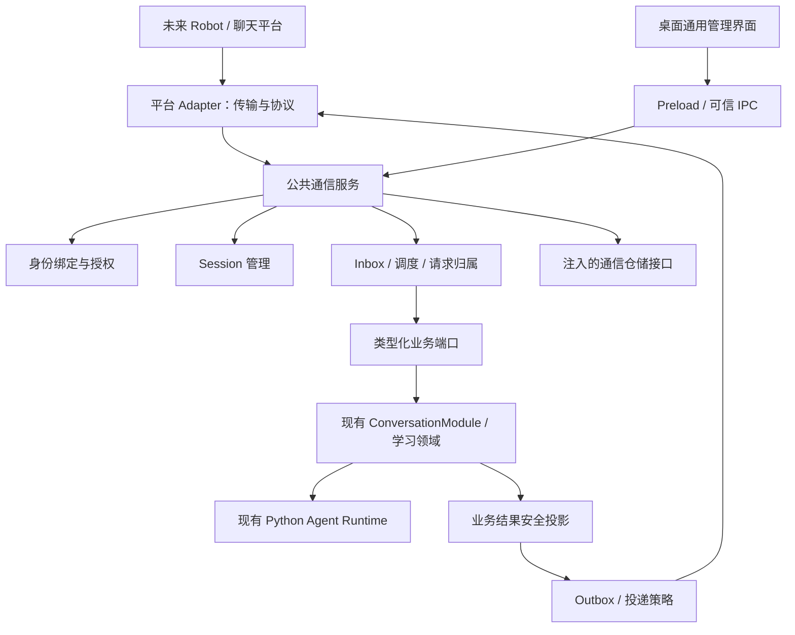

# 公共通信模块实施计划

- 日期：2026-11-03
- 状态：待实施
- 范围：所有聊天平台共用的通信基础设施、宿主装配、持久化、管理接口及测试；具体 Robot 和聊天平台 Adapter 另行实施

## 目标

建立平台无关的公共通信模块，让 Telegram、微信、飞书、Discord 等未来聊天平台通过统一契约接入 Lingo Mate。公共模块完整承载接入之后的身份绑定、授权、session 管理、消息去重、队列、请求归属、执行协调、回复投递和恢复能力；具体 Robot／聊天工具 Adapter 只负责平台协议与网络收发。

新增平台时，应实现 Adapter、声明能力并在 Main 静态装配，不应复制身份绑定、session、Inbox、Outbox 或业务执行逻辑，也不应向公共模块添加平台名称判断。可扩展接口不代表已支持对应平台；只有具体 Adapter 完成适配和验证后才能声明平台支持。

本次交付公共模块及两个能力不同的测试 Adapter，不连接真实平台、不创建真实 Bot、不发送真实外部消息。本计划仅描述待实施工作，不授权打开、迁移或修改真实用户数据库。

## 与现有计划的关系

[聊天平台接入实施计划](2026-09-11-chat-platform-integration.md) 包含 Telegram MVP 和后续微信接入。本计划提取并细化其中的平台无关基础设施，是具体平台接入的前置计划。

后续平台计划应复用本计划的实现，仅承担具体平台 Adapter、平台特有配置、实际收发验证和必要部署。原计划中自然语言收藏确认等新 Agent 行为不在本计划实现；如实施，任务识别、Prompt 和策略必须进入 Python，通信模块只管理确认的归属、有效期和执行授权。完成本计划不代表 Telegram、微信或原接入计划已完成。

## 当前代码基线

| 位置 | 当前职责与接入影响 |
| --- | --- |
| `src/core/conversation/conversation-module.ts` | 已有会话、普通对话、显式技能、取消和安全结果事件；是业务复用入口，不另建聊天平台 Agent。 |
| `src/core/conversation/conversation-execution.ts` | 已维护 requestId、sessionId、语言快照及同会话单执行；公共模块须遵守现有限制，不新增并行业务执行路径。 |
| `src/main/conversation-ipc.ts` | 请求归属绑定 WebContents，窗口销毁时取消；外部请求需要独立归属，不能模拟窗口或绕行 IPC 来源校验。 |
| `src/shared/conversation.ts` | 已有输入、完成、失败、取消和技能结果协议；通信模块复用并筛选事件，不把内部状态外发。 |
| `src/main/index.ts` | 装配 Agent、领域服务、仓储与退出清理；需增加公共通信宿主的装配和有界关闭。 |
| `src/database/database.ts` | 打开数据库会自动执行迁移；验证只能使用临时数据库，不能通过启动应用触发真实数据升级。 |

当前 `createConversation()` 先创建内存草稿，首次消息时才落库；当前语言来源为全局 resolver。实施时必须显式解决持久化 session 映射与草稿重启丢失，以及每次执行独立语言上下文的问题。

## 范围与职责边界

### 公共模块包含的能力

- 连接注册、能力协商、公共连接状态、启动／停止协调和凭据引用管理。
- 外部身份规范、绑定码、桌面确认、解绑、权限白名单、确认票据和授权撤销。
- 外部 session 到内部会话的映射、创建与切换、语言上下文、空闲过期和归属校验。
- 入站协议校验、持久化接收、去重、消息有效期、接收确认及游标保存契约。
- 有界队列、按 session 串行调度、账号限流、全局背压、请求归属和取消。
- 通信控制命令、到现有业务入口的类型化分派，以及安全事件投影。
- Outbox、结果路由、分段投递记账、限流退避、发送结果不确定状态和重启恢复。
- 仓储契约、时钟／随机源／定时器等可替换依赖、安全错误、诊断和保留清理策略。
- 通用管理 API、最小桌面管理界面和可供所有 Adapter 复用的契约测试。

“公共模块包含全部平台无关能力”指这些规则只有一份实现。Core 持有规则与接口，Main 持有系统能力及生命周期，Database 实现仓储；不把网络凭据、数据库实现或 Electron API 塞入同一个 Core 类。

### Robot／聊天平台 Adapter 的边界

| 公共通信模块负责 | Adapter 负责 |
| --- | --- |
| 绑定、鉴权、授权撤销、session 和请求所有权 | 平台传输认证、Webhook 验签及平台原始载荷校验 |
| 入站去重、Inbox、消息有效期、游标持久化与确认时机 | polling／Webhook／长连接及平台游标格式转换 |
| 调度、取消、公共命令、业务入口选择 | 平台命令实体、提及和按钮事件转换为标准事件 |
| 重试决策、次数／时间预算、限流等待和投递账本 | 一次实际发送／编辑／上传，将平台错误映射为标准结果 |
| 回复内容、安全投影、降级规则和投递目标授权 | 平台格式转义、长度计算、分段编码和平台消息 ID |
| 连接状态机、生命周期策略、凭据引用 | SDK 初始化、平台鉴权握手和连接资源清理 |

Adapter 不能访问业务数据库、直接调用 Agent、决定绑定关系、选择任意内部 sessionId 或私自重试业务。SDK 的隐式发送重试应关闭或纳入统一投递预算，避免两层重复重试。仅凭传输验签通过不能视为用户已绑定。

### 本次不实施

- 具体 Telegram／微信等生产 Adapter、平台网络代理、云端中继或常驻服务器。
- 多租户业务数据模型、群聊共享学习资料、跨平台自动合并上下文。
- 新的学习技能、自然语言任务识别、Prompt、Agent 图或长期学习记忆。
- 完整附件下载／处理、语音识别、音频转码、主动推送和定时任务；保留能力扩展位置，不提前实现空流程。
- 动态插件加载、任意工具执行、通用 HTTP／SQL／文件访问接口。

首版只开放已绑定本地用户的私聊文本；消息模型可表达群聊／话题和附件描述，但未支持的输入在调用业务前明确拒绝。桌面应用运行之外的可用性不由公共模块承诺。

## 目标架构与依赖



- Core 不导入 Main、Electron、平台 SDK 或具体数据库实现；公共契约不依赖某个平台的类型。
- Main 注入仓储、凭据库、业务端口和 Adapter；业务端口在可信宿主侧调用现有 Module，不通过 Renderer 或伪造 IPC。
- 通信模块不成为会话正文、学习资料、事务或 Agent 运行时的第二个所有者；通信表保存路由、归属、执行关联和必要投递内容。
- 现有桌面聊天可以继续走原 IPC；不强制把 Renderer 改造成网络 Adapter。桌面窗口销毁取消规则保持原样，渠道请求独立于窗口存在。
- 所有 Agent 请求仍经过现有 Python 运行入口；外部平台用户 ID、凭据、游标与连接详情不发送给 Python。

## 建议目录

```text
src/core/communication/
├── communication-service.ts       # 公共入口，组合以下职责
├── communication-contract.ts      # 平台无关消息、能力、回执及 Zod schema
├── communication-adapter.ts       # Adapter 收发、编码与生命周期契约
├── communication-repository.ts    # 仓储与原子操作契约
├── identity-binding.ts            # 身份绑定、撤销和确认票据
├── communication-session.ts       # 外部路由、内部会话和语言上下文
├── request-ownership.ts           # 渠道请求归属与取消授权
├── inbox.ts                       # 接收、去重及执行状态
├── dispatcher.ts                  # 有界调度、限流、控制命令和业务分派
├── business-port.ts               # 到现有业务能力的受控端口
├── reply-projection.ts            # 安全结果投影、国际化和能力降级
├── outbox.ts                      # 投递状态、预算与恢复
└── __tests__/                     # 两种测试 Adapter 及契约测试等

src/main/communication/
├── communication-host.ts          # 公共装配、系统依赖及应用生命周期
├── conversation-business-port.ts  # 复用现有会话 Module 的宿主实现
├── communication-ipc.ts           # 通过公共 IPC guard 注册管理接口
├── credential-store.ts            # 通用凭据安全存储与引用
└── __tests__/

src/main/channels/                 # 后续具体平台 Adapter，本计划不添加生产实现
src/database/                     # 通信仓储实现与迁移、相应 __tests__/
src/shared/communication.ts        # 桌面管理 DTO、IPC 常量和安全展示 schema
src/renderer/src/settings/channels/ # 通用连接／绑定管理及 __tests__/
tests/integration/                # 公共通信与真实领域入口的集成测试
```

目录按实际职责拆分，避免一个 service 同时维护多个状态机；也不要求每个辅助类型独占文件。Core 协议与桌面 DTO 分开，Shared 不暴露完整入站载荷、内部账本或凭据。生产 Adapter 使用静态注册，未知 adapterId 在建立连接前失败。

## 核心设计约定

### 1. 身份与标准消息

明确区分以下身份，不能互相替代：

| 身份 | 用途 |
| --- | --- |
| `adapterId` | 已注册的平台实现类型 |
| `connectionId` | 本机的一条连接／一个 Bot 实例；同平台可有多个 |
| `externalActorId` | 平台稳定用户 ID，不能使用可修改的昵称作为授权依据 |
| `externalConversationId`、`externalThreadId` | 平台聊天及可选话题 |
| `principalId`、`bindingId` | 本地用户主体和具体授权绑定；首版仍为单个本地用户 |
| `communicationSessionId`、`sessionId` | 通信上下文与已有内部业务会话 |
| `externalEventId`、`externalMessageId` | 传输事件去重和平台消息定位；同消息的不同事件不能混为一谈 |
| `requestId`、内部 messageId | 一次业务执行，以及业务持久化消息身份 |
| `deliveryId`、`partId` | 一个逻辑回复及其实际发送片段 |

外部 ID 统一使用有长度限制的字符串。标准事件采用判别联合，首版包含文本和受控交互；携带连接、外部身份、会话范围、时间和必要内容，禁止转交不受约束的原始 SDK 对象。connectionId 由可信装配绑定，不能直接信任平台正文中的声明。

Adapter 执行平台原始协议校验，公共入口再次校验标准 schema、连接归属、大小和支持范围。编辑、撤回、服务事件等若未实现，明确忽略或拒绝，不把它们转换成新的业务请求。

### 2. 统一 Adapter 契约与能力声明

契约至少包含：

- 启动、停止和连接状态回报；停止可重复调用，结束后不能提交新消息。
- 将标准入站事件交给公共入口，并等待持久化接收回执。
- 根据能力把逻辑回复编码为受限的发送片段；编码无外部发送副作用。
- 对给定片段执行一次发送／编辑，返回外部消息引用或标准失败结果。
- 标准错误分类：确定未发送且可重试、限流及等待时间、永久失败、发送结果不确定。
- 消息编辑、交互按钮、附件、可用长度等能力描述；能力声明不能授予业务权限。

公共模块根据能力选择呈现方式，Adapter 负责平台格式。编码结果持久化后再发送，重试使用同一片段及版本，不因重新分段改变已发送部分。实际重发前重新检查连接和绑定授权。

公共入口返回“已持久化接收”“已持久化拒绝”或“接收失败”的明确回执。polling offset、Webhook 成功应答等平台确认动作只发生在持久化回执之后；Adapter 使用回执更新传输状态，游标的可靠保存由公共仓储提供。游标作为有大小上限的不透明数据保存，不在公共层解释平台格式；失败时宁可重投并去重，也不能先确认后丢失事件。

### 3. 绑定、授权与确认

1. 本地管理界面为指定连接创建短时、一次性绑定挑战，持久化摘要、有效期及尝试预算，不记录明文绑定码日志。
2. 未绑定账号只能提交绑定挑战，不能访问模型、会话或学习资料。
3. 外部账号提交后进入待本地确认，管理界面展示必要的平台与账号标识；确认原子创建绑定并消耗挑战。
4. 绑定映射到本地 principal，并关联显式能力白名单。新增平台不会自动获得全部现有业务能力。
5. 解绑立即阻止新执行，移除待执行任务，取消该绑定拥有的活动请求，阻止尚未发送的业务内容；已提交的领域结果不回滚。

挑战必须校验连接、有效期、尝试次数和一次性消费，防止并发抢占、暴力尝试及重放。显示昵称只用于核对。绑定／重绑不自动继承旧 session 或旧待发消息。

公共模块提供确认票据基础设施，绑定 principal、binding、session、原始事件、操作类型、参数摘要、有效期和一次性状态。按钮和纯文本确认走同一验证规则；不支持按钮的平台可用文本完成同样流程。是否需要某项业务确认由业务策略决定，通信模块不自行用模型猜测用户授权。

### 4. Session 生命周期

- 默认映射键为 connection、外部会话、可选话题、绑定主体及学习语言范围；首版仅接受私聊，仍检查发送者与绑定一致。
- 同一主体的不同平台／连接默认隔离对话上下文，共享的学习资料由原有领域仓储及语言归属规则决定。
- 外部输入不能指定或枚举任意桌面 sessionId。内部 session 的读取、取消、恢复和结果路由都校验所属通信映射。
- 首次接受业务消息时，以可靠仓储操作建立持久化内部会话与映射，解决现有内存草稿的重启丢失；失败不能留下指向不存在会话的映射。通过扩展现有会话接口实现，不在通信模块复制会话存储逻辑。
- `/new` 创建新的通信上下文，保留历史归属。与普通消息按序处理；存在活动任务时明确反馈忙碌，由用户取消后再切换，不隐式丢弃活动结果。
- `/cancel` 作为控制操作优先处理，不排在待取消任务之后；只能取消当前绑定拥有的指定请求或当前 session 请求。
- 定义空闲过期和显式结束策略；新上下文不删除旧业务历史，历史内容也不自动发送到外部平台。
- 回复目标在接受任务时冻结，不能在完成时读取“当前 session”重新决定收件人，避免切换或重绑导致错发。

每次执行显式冻结界面提示语言、讲解／反馈语言和目标学习语言，传给现有业务入口。首版来自已绑定本地用户的有效设置，不通过修改全局 resolver 临时切换语言；目标语言变化后创建相应的新上下文。通信契约不硬编码英语，实际准入仍限制为项目已验证支持的语言。Prompt 输出语言继续由 Python 显式指定。

### 5. 入站、调度和请求归属

Inbox 以 `(connectionId, externalEventId)` 建唯一约束，并关联标准消息、绑定版本、session、稳定 requestId 和内部消息身份。重复事件返回已有接收结果，不能再请求模型或重复执行业务。相同事件 ID 携带不同内容时拒绝并记录安全诊断。

执行状态分开记录：

```text
received -> queued -> dispatching -> running -> succeeded / failed / cancelled
                  \-> expired / rejected
dispatching / running --进程中断--> interrupted（等待核对，不自动重放）
```

绑定和确认使用独立状态，不能靠重投原始消息完成授权升级。执行前再次检查绑定版本、有效期、能力白名单和语言支持；待确认操作只能由一次性票据释放。

- 同一内部 session 串行，跨 session 仍服从现有领域锁和 Agent 全局预算。通信层不能扩大现有并发额度。
- 明确设置连接／账号速率、单 session 队列长度、全局积压、消息大小、消息有效期和确认有效期；首阶段固定默认值、计量单位和稳定错误码，并以可控时钟验证边界。
- 队列满或消息过期时在持久化拒绝后反馈，不静默丢弃，也不无限堆积。控制命令保留独立的有界准入。
- requestId 在调用业务前持久化，归属绑定 principal、binding、session 和入站事件。业务端口不接受 Adapter 自报授权。
- 授权撤销、退出和取消通过既有 AbortSignal／取消接口传递；业务已提交部分按原有领域语义保留。
- 普通业务失败、启动失败和协议错误都明确结束，不自动回退或重跑。

队列恢复只可处理能够证明尚未越过 dispatching 边界、且授权和有效期仍成立的记录；无法证明是否已调用业务的记录统一进入 interrupted。不同进程不能同时消费同一连接；首版由桌面单实例及仓储原子认领防止重复消费。

### 6. 业务端口与结果投影

提供最小、类型化的业务端口：建立持久化会话、提交普通消息、提交已授权显式技能、取消、查询可证明的既有执行结果。具体实现复用 ConversationModule 和已有领域 Module。

- `/new`、`/cancel`、`/help` 等通信控制命令由公共 dispatcher 统一处理；平台别名转换不能实现另一套控制规则。
- 显式技能使用公共白名单映射至现有类型化入口；自然语言直接交现有 Python 策略，不在 TS 添加意图模型或 Prompt。
- 技能参数校验、词形规则、写入事务、用量统计和结果恢复仍由原领域持有。
- 结果投影只允许必要的最终答复、已授权报告摘要和安全错误；不外发 reasoningChunk、内部工具载荷、模型原始诊断、凭据、记忆证据或桌面历史。
- 首版聚合最终答复，可发送有界的处理状态；不逐 token 外发。为以后节流编辑保留事件投影边界。
- 所有静态回复及错误通过统一 i18n key 获取，覆盖当前支持的语言；动态内容采用插值，不能拼接可翻译文案。

业务执行、领域成功提交、通信执行账本与 Outbox 不是天然原子事务。实施时为每个开放操作确定可验证的完成关联：能在同一 SQLite 事务提交的，使用注入的事务端口；跨事务或 JSON 文件技能依赖原有恢复身份和只读核验。不能仅凭“最后一条 assistant 消息”猜测技能是否提交，也不能把临时 chunk 当成成功结果。

完成关联和 Outbox 在公共仓储中原子登记。业务已提交但通信登记前崩溃时，只读核对原有结果，补登记和补发；无法证明时保留 interrupted 并提示用户核对，不为生成回复再次执行业务。无法提供可靠结果关联的技能不进入首版远程白名单。

### 7. Outbox 与恢复

执行结果和投递状态分别维护：业务成功不等于外部发送成功。

```text
pending -> sending -> sent
             \-> retry_wait -> sending
             \-> failed / uncertain / suppressed
```

- 逻辑回复关联 requestId、binding 版本、冻结目标、必要正文、编码版本和片段；各片段独立记账，已确认发送的片段不因后续片段失败而重发。
- 确定未发送的临时错误、明确限流可按有界指数退避和平台等待时间重投；永久失败结束，达到预算后进入 failed。
- 网络超时等无法证明是否发送的情况进入 uncertain。首版不自动重发这类片段，管理界面允许用户显式处理，并说明可能重复；不承诺跨平台严格 exactly-once 投递。
- 回复失败只处理已保存结果，绝不重新请求 Agent、重跑收藏或触发模型总结。
- 重启后 sending 状态按 uncertain 处理；已保存的待发送结果在重新检查授权后恢复。解绑、连接删除和投递过期将结果标记 suppressed，不改投其他账号。
- 接收、执行、投递的错误和状态分别展示；消息发送错误不能逆向改写领域提交结果。

### 8. 持久化、保留与宿主生命周期

预计持久化实体如下，具体表和索引在实施阶段结合现有迁移确定：

| 实体 | 保存内容与关键约束 |
| --- | --- |
| connections | adapterId、连接实例、启用状态、非敏感配置和 credentialRef |
| binding_challenges / bindings | 挑战摘要、有效期、主体、绑定版本、能力和撤销状态 |
| communication_sessions | 外部范围、语言归属、内部 sessionId、活动上下文及创建／结束时间 |
| confirmations | 原始事件和操作摘要、所属绑定／session、有效期及一次性消费状态 |
| inbox / requests | 入站唯一键、最小必要内容、执行身份、认领状态及终态关联 |
| transport_cursors | 每连接的有界不透明接收游标及版本 |
| outbox / delivery_parts | 逻辑结果、授权目标、编码片段、外部消息引用及发送状态 |

凭据明文仅在 Main 安全存储／使用，Core 仅持有 credentialRef；Renderer 可提交新凭据但不能回读。凭据更新引起连接代次变化，旧连接回调不能继续提交消息。公共宿主管理凭据接口及失败语义，具体平台字段校验由后续 Adapter 设置扩展提供。

需要明确接收内容、投递正文、去重记录和终态记录的保留期及清理策略；正文可早于去重墓碑清理，不能清理后让旧事件重新执行业务。结合入站有效期拒绝过旧事件。绑定挑战和诊断不额外复制业务正文，保留原领域历史生命周期。

通用连接状态包含 stopped、starting、online、reconnecting、error、stopping；状态更新绑定连接代次，迟到回调不能复活已停止连接。公共宿主制定有界重连策略，Adapter 提供一次连接动作及失败分类。

应用退出顺序：停止接收与新准入 → 停止调度／投递 → 取消或有界等待活动业务及发送 → 持久化可确认状态 → 释放 Adapter → 关闭 Agent、仓储和日志。停止不自动清空 Inbox／Outbox；不能在数据库关闭后处理迟到回调。窗口关闭不等于所有渠道任务取消，首版仍遵循当前各 OS 的应用退出行为，不隐式启用后台常驻。

### 9. 管理 API 与可观察性

通过 `registerTrustedHandler` 暴露列举连接、启动／停止、创建挑战、确认／撤销绑定、查看安全状态、取消所属请求及显式处理投递的窄接口；同步 preload 实现和类型声明，输入／返回均校验。管理 UI 放在 settings/channels，遵循现有视图切换与焦点规则。

本计划提供通用状态与绑定管理界面；无生产 Adapter 时显示国际化空状态，不伪造可连接的平台。平台 Token 表单和网络设置由后续平台计划补充。

诊断通过 connectionId、requestId、deliveryId 关联，区分认证、授权、接收、执行和发送故障。日志脱敏且不写完整平台载荷、Token 或含凭据 URL；Renderer 只接收最小安全状态和可操作错误。首版无需新增外部遥测服务。

## 实施步骤

### 1. 固定契约与行为基线

- [ ] 定义标准消息、身份、连接能力、接收确认、投递回执及 schema，确定状态迁移表。
- [ ] 固定所有队列、有效期、限流、重试及保留默认值；明确超限错误和清理后的重投规则。
- [ ] 清点现有技能的完成关联与恢复接口，确定首版远程白名单；不把不可靠的恢复假设留给 Adapter。
- [ ] 建立两个测试 Adapter：仅最终文本与支持编辑／交互的实现，均不连接网络。
- [ ] 先写身份隔离、接收去重、取消归属和未知能力拒绝的失败测试，再开始实现。

阶段验收：新增 Adapter 所需契约明确，平台无关规则没有落入测试 Adapter，现有桌面与 Agent 边界有回归基线。

### 2. 绑定、Session 与仓储

- [ ] TDD 实现绑定挑战、桌面确认、能力授权、票据消费和撤销。
- [ ] 实现 session 映射、持久化会话创建、上下文切换及显式语言快照。
- [ ] 编写通信仓储与迁移代码，仅在临时数据库验证原子性、唯一约束和历史数据兼容。
- [ ] 验证未绑定、跨连接、跨账号、重绑、语言切换及不存在会话映射的拒绝行为。

阶段验收：身份和 session 可以跨重启可靠恢复；无任意内部会话访问，无真实用户数据操作。

### 3. 接收、调度与业务复用

- [ ] 实现 Inbox、持久化接收确认、游标保存、去重和过期处理。
- [ ] 实现有界队列、限流、session 串行、优先取消及绑定撤销后的停止准入。
- [ ] 实现公共控制命令、业务端口及宿主实现，复用现有 ConversationModule。
- [ ] 持久化执行关联，验证 dispatching／running 中断不自动重跑。
- [ ] 覆盖不同会话并发、同会话桌面／渠道冲突和领域原有串行锁，不扩大运行预算。

阶段验收：两个测试 Adapter 均能完成绑定、创建会话、问答／白名单技能和取消，业务只执行一次。

### 4. 结果投影、投递与故障恢复

- [ ] 实现安全结果投影、国际化静态回复、能力降级及确定性编码契约。
- [ ] 实现 Outbox、片段账本、限流退避、发送预算和 uncertain 处理。
- [ ] 完成业务提交与通信记账间各崩溃窗口的结果核对，无法证明时保留中断状态。
- [ ] 验证结果补发不调用模型或写入业务，重绑／解绑／过期后不会错投。
- [ ] 实现保留清理，验证去重墓碑与消息有效期共同阻止旧消息重执行。

阶段验收：执行与发送故障独立，恢复只使用可证明的已有结果；所有投递可追踪到原始授权目标。

### 5. 宿主装配、管理界面与文档

- [ ] Main 装配公共宿主、仓储、凭据库和业务端口，实现连接代次及有界退出。
- [ ] 增加可信管理 IPC、preload API 和通用设置界面；补齐全部语言资源及组件测试。
- [ ] 验证无生产 Adapter 的空状态、凭据不回读、窗口销毁不误取消渠道请求。
- [ ] 编写 Adapter 接入指南及可复用契约测试，说明真实平台需要另外完成的验证。
- [ ] 同步架构职责文档，并在原聊天平台接入计划中明确复用本模块的剩余工作。

阶段验收：平台无关逻辑只有一份；实际生产 Adapter 缺席不影响公共模块独立验证，也不被宣称为平台接入完成。

### 6. 全量验证与交付

- [ ] 执行下述验证，记录测试范围、故障注入结果与 E2E 状态。
- [ ] 检查依赖方向、数据暴露、迁移边界和已有 Python 任务路径。
- [ ] 全部计划工作及相关验证完成后，将本计划状态更新为“已实施”；未完成时保留实际状态和剩余事项。

## 测试与验证

核心逻辑、状态迁移、IPC 与安全边界采用 TDD：围绕公开行为先确认预期失败，再实现和重构。使用可控模型、时钟、网络结果、测试 Adapter、临时目录及临时数据库；生产代码不依赖测试 fixtures。

| 测试范围 | 必须验证的行为 |
| --- | --- |
| Adapter 契约 | 两种能力组合复用同一入口；标准消息校验、接收确认后才推进游标、停止后无新事件、单次发送与标准错误分类。 |
| 绑定与授权 | 码过期、错误连接、超出尝试预算、并发消费、桌面确认、票据重放、跨 session 确认、撤销即时生效。 |
| Session | 映射可靠创建、草稿崩溃无悬空引用、平台／连接／话题隔离、new 忙碌规则、绑定版本及语言上下文隔离。 |
| Inbox 与队列 | 重投不执行业务、同 ID 不同内容拒绝、游标落库失败可安全重投、队列满和消息过期、同会话串行及全局背压。 |
| 请求归属 | 其他账号不能取消／读取、取消不被普通队列阻塞、窗口销毁不影响渠道请求、解绑移除队列并取消所属执行。 |
| 业务端口 | 使用现有技能及真实 Python 管道，输入和语言校验不削弱；未开放技能零副作用，TS 无新 Agent 路径。 |
| 提交与恢复 | 接受前后、dispatching、领域提交、终态登记、Outbox 创建各边界崩溃；只读核对、未知结果不重跑。 |
| 投递 | 长回复片段、部分成功、明确限流、永久失败、超时 uncertain、重启 sending、预算耗尽；重发模型调用次数不增加。 |
| 结果隐私 | 不外发 reasoning、内部工具、诊断原文或桌面历史；静态提示国际化，格式编码不改变授权目标。 |
| 生命周期 | 重复 start／stop、凭据更新旧回调、断线重连、退出有界收敛、数据库关闭前停止任务、无迟到发送。 |
| 持久化与清理 | 升级仅增所需结构、外键和唯一约束、临时数据库回归、正文清理后去重仍有效、授权撤销后不恢复旧 Outbox。 |
| 管理接口与 UI | 可信来源、输入／输出 schema、归属、安全错误、凭据不回读、双语空状态及键盘焦点。 |

单元／组件测试放在所属模块 `__tests__/`，跨模块测试放在 `tests/integration/`。测试 Adapter 用于单元与集成验证，不启动端到端测试，也不代替未来真实平台验收。

实施阶段完成后运行：

```sh
# 首次准备环境及全量测试前确保锁定 Python 环境同步
pnpm agent:sync
pnpm lint
pnpm typecheck
pnpm test
pnpm build

# 本计划涉及宿主集成，验证现有跨语言边界
pnpm agent:protocol
pnpm agent:test
pnpm agent:check
```

预计不改变 Python 协议和运行包。若实际需要变更，按项目约定先调整范围、更新唯一 Zod 契约及生成物，并补充相应真实管道测试；涉及启动／分发再执行 `pnpm agent:build`、`pnpm agent:smoke`。

执行任何 E2E 前必须另行询问并取得用户明确许可；未获许可不执行，也不作为阻塞项，交付注明“E2E 未执行，按约定默认无问题”。真实账号连接及真实外发验证留给具体平台计划，并须在明确授权的测试范围内执行。

本次只新增 Markdown 计划，检查文档、相对链接和差异，不启动应用、不执行迁移、不运行功能或 E2E 测试。

## 完成标准

- [ ] 公共通信模块独立覆盖除平台 Adapter 外的全部通信规则，包括身份绑定、session、权限、接收、调度、执行关联和投递恢复。
- [ ] 两个能力不同的测试 Adapter 通过同一套契约及集成测试，公共模块没有平台专属分支或 SDK 依赖。
- [ ] 新增生产平台只需实现 Adapter、平台配置扩展和 Main 静态装配；如需新交互能力，只扩展通用能力契约及对应测试。
- [ ] 复用既有会话、领域规则、持久化和唯一 Python Agent，无第二套会话正文仓储、无静默回退或失败自动重放。
- [ ] 归属、取消、撤销、崩溃恢复、去重、投递不确定性和数据清理均有公开行为测试。
- [ ] 通用管理 API、界面、国际化、凭据隔离和退出生命周期完成，真实用户数据未被未经询问操作。
- [ ] 文档、验证记录与实际支持范围一致；本计划完成不被等同于任何真实平台已接入。

## 回退约定

按阶段独立交付。关闭公共通信入口后，原桌面聊天及 Agent 路径仍可使用。回退停止接收、调度与投递，保留可核对的通信账本及领域已提交结果，不自动清空、降级迁移或重放失败请求；真实用户数据回退操作同样先询问用户。
